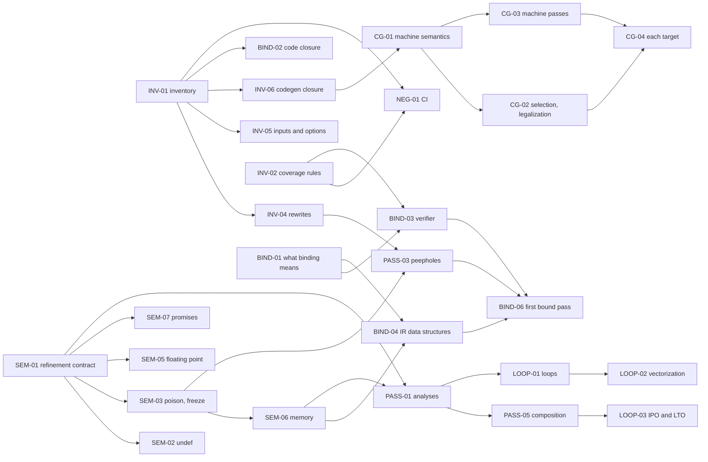

# Proving every optimization in LLVM: tasks

**Parked on 2026-11-08.** Proving every optimization in a pinned LLVM is no longer an end goal. The
[roadmap](roadmap.md) says what is, proved superoptimization with proof tests as a second product, and
[why it changed](roadmap.md#the-goal-changed-on-2026-11-08). This page stays as a reference: the inventory of the
pinned LLVM's passes, the rules for what counts as done, and the tasks, with their statuses kept true and checked by
`tests/llvm_scope.py`. Some tasks are tools the roadmap uses, and [what the roadmap keeps](#what-the-roadmap-keeps)
lists them. The rest wait with the program, which comes back as a goal only by a change the roadmap writes down with
its reason.

The end condition, as it was set: every optimization in a pinned LLVM revision, across all optimization levels and
supported targets, has machine-checked correctness proofs tied to its actual implementation, covering all permitted
inputs and composition through optimization pipelines. Assumptions are explicit and justified. Timeouts, unsupported
cases, admitted proofs and proof-to-code gaps count as unfinished.

**None of it is done.** The inventory lists all 1162 names the pinned source registers a pass or codegen implementation under. That's registration
coverage: it says what exists, not what's proved, and it isn't the number of semantically distinct optimizations,
since some names share code, some code has several names, and each pass holds many rewrites. Proof coverage is 0:
no name is verified done, and none is even claimed complete. This page is the plan the program had: what the
denominator is, how a pass gets counted, and the tasks between here and there, with what each depends on and owns. For
what any theorem means, see [trust](trust.md).

## What the roadmap keeps

These tasks are tools for the roadmap's goal, or its fidelity work, and go on under it. Everything else here waits with
the program, including binding proofs to LLVM's C++, BIND-02 to BIND-05, which the roadmap parks by name.

| Task | Status | In the roadmap |
| --- | --- | --- |
| INV-01 to INV-03, NEG-01 | Complete | The inventory and its checks, kept as a reference and run in CI |
| SEM-01 | Complete | `IRLean.Refines`, the statement every certificate proves, in [Phase 4](roadmap.md#phase-4-certified-translation-validation-and-superoptimization) |
| SEM-07 | Complete | Milestone F2, reached in [#62](https://github.com/phongndo/ir-lean/pull/62). The safety bridge waits on F4 now |
| SEM-03 | Complete | Milestone F3, `freeze` in the model, with `undef` kept out, as the maintainer [decided](roadmap.md#three-decisions-of-2026-11-09) on 2026-11-09. Done in [#72](https://github.com/phongndo/ir-lean/pull/72) |
| SEM-02 | Blocked | Kept out of the model by the same decision: `undef` constants stay refused, and uninitialized memory reads as poison |
| SEM-06 | Not started | Milestone F4, after F3. Superoptimizer v2's memory candidates and the safety bridge need it |
| SEM-04, SEM-08, SEM-10 | Not started | [Phase 0](roadmap.md#phase-0-semantic-fidelity-and-trust-infrastructure)'s fidelity work |
| AUTO-01 | In progress | A tactic the engine can try for `Refines` |
| AUTO-02 | Not started | The [lemma store](roadmap.md#phase-6-the-engine-and-the-lemma-store) |
| AUTO-03 | In progress | Rewrites at every width, the lemma store's seed |
| NEG-02, NEG-06 | Not started | The gates that keep wrong and unknown results from counting |
| NEG-03, NEG-05, NEG-07 | Not started | Phase 0: mutation, which is the roadmap's slice 12, determinism, and the hermetic pin |

## How it's measured

[`tests/llvm_scope.py`](../tests/llvm_scope.py) derives the inventory from the pinned source and tools, and checks the
claims against it and this page against itself:

```console
nix develop -c tests/llvm_scope.py check     # derive the inventory again, and fail on any difference
tests/llvm_scope.py summary                  # the numbers below, from the files in the repo
tests/llvm_scope_test.py                     # refusals of claims and tasks that overstate what was shown
```

| File | What it holds |
| --- | --- |
| [`tests/llvm_scope/inventory.json`](../tests/llvm_scope/inventory.json) | One line per pass: its registrations, kind, targets, the source files that implement it with their hashes, and its `cl::opt` count. Also the exact pipelines `opt` prints for each phase and level, and what `llc` runs for each registered target and level |
| [`tests/llvm_scope/coverage.json`](../tests/llvm_scope/coverage.json) | Claims about passes, in the shape of [`coverage.schema.json`](../tests/llvm_scope/coverage.schema.json). It has none, because nothing in the repo proves an optimization correct yet |
| This page | The tasks. `check` parses them |

### Translation validation isn't proof for all inputs

A pass has four things to show, and is done only when the last three are complete with evidence, in every context it
runs in:

| Dimension | Says | Counts toward done |
| --- | --- | --- |
| `translation-validation` | For finitely many inputs, such as LLVM's own regression tests, what the pass produced refines what it was given | **Never.** A thousand certified outputs say nothing about the next input. It's recorded, as progress and as a source of counterexamples |
| `all-input`, or `analysis-soundness` for an analysis | Every rewrite the pass can make is proved for every permitted input, or every fact the analysis reports is proved true | Yes |
| `code-binding` | The pass's C++, at the hashes the inventory pins, is proved to make only those rewrites | Yes. A binding with other hashes is stale and refused |
| `composition` | The pass is correct inside every pipeline it runs in, with the analyses it reads, preserves and invalidates | Yes |

The checker refuses a complete claim with no evidence, with evidence outside the repo or whose hash changed, with gaps
listed, or with only finite evidence for an all-input dimension. A claim covering some contexts is partial. `partial`,
`admitted`, `timeout`, `unsupported` and `failed` are all unfinished, and so is a missing claim.

Even a claim that passes all of that is only **unverified**. Its status and hashes are written by whoever makes the
claim, so they can't make a pass done by themselves. A dimension is complete only when an independent verifier for its
evidence kind replays the evidence and decides it covers every context the pass runs in. No verifier exists yet:
[BIND-03](#bind-03-an-independent-verifier) is to write them. Until then the summary counts claims as complete only
under `claimed_complete`, and `verified_done` stays 0.

## The measured scope

Measured on z from the dev shell's LLVM, on top of `18421be`. The comment below is what the tests compare with the
inventory, so this section can't drift from it.

<!-- scope: {"registered_names": 1162, "verified_done": 0, "claimed_complete": 0, "names_with_several_implementations": ["kcfi", "mir-debugify", "print", "verify"], "classes_under_several_names": {"new:ModuleInlinerWrapperPass": ["inliner-ml-advisor-release", "inliner-wrapper", "inliner-wrapper-no-mandatory-first"], "new:NewPMDebugifyPass": ["debugify", "mir-debugify"], "new:OpenMPOptPass": ["openmp-opt", "openmp-opt-postlink"], "new:PGOCtxProfFlatteningPass": ["ctx-prof-flatten", "ctx-prof-flatten-prethinlink"], "new:PGOInstrumentationGen": ["ctx-instr-gen", "pgo-instr-gen"]}, "in_unbuilt_targets": 37, "by_category": {"analysis": 142, "emission": 24, "instrumentation": 36, "printer-verifier-debug": 129, "transform": 831}, "generic": 663, "unresolved_code": 7, "never_seen_in_a_pipeline": 531, "opt_pipelines": "20 of 30 phase and level pairs build", "llc": "48 registered targets x 4 levels, 15 with a probe failing", "target_dirs_not_built": ["ARC", "CSKY", "DirectX", "M68k", "Xtensa"]} -->

| | |
| --- | --- |
| **Pin** | LLVM 23.1.3, tag `llvmorg-23.1.3`, commit `0d261d1ca552c95a8f007e061c787ac7132fbcbc`, from nixpkgs `1d060086d60c` in `flake.lock` |
| **Registered names** | 1162 distinct names, from 1566 registrations: 447 in `PassRegistry.def`, 134 in `MachinePassRegistry.def` and 214 in 12 targets' `*PassRegistry.def` for the new pass manager; 729 in the legacy registry, 725 through `INITIALIZE_PASS` and 4 through `RegisterPass<T>`, the only two ways into it in `llvm/PassSupport.h`; and 42 entries in the 7 registries an option picks a codegen implementation from, named as the option picks them, such as `regalloc=greedy`, `misched=ilpmax` or `pre-RA-sched=list-burr`. Each name `opt -print-passes`, a pipeline or `llc --help-list-hidden` lists is among them. `misched=shuffle` is registered only in assertion builds, so the pinned `llc` doesn't list it, and it counts |
| **Not the number of optimizations** | Names that are the same in two registries are one entry: 378 names have both a legacy and a new pass manager registration, which is the same pass. But 4 names cover code in more than one file, so they undercount: `verify` is both the IR verifier and the machine verifier, and `kcfi`, `mir-debugify` and `print` are similar. 5 classes run under more than one name, so they overcount, such as `openmp-opt` and `openmp-opt-postlink`. And one name such as `instcombine` holds hundreds of rewrites, which [INV-04](#inv-04-rewrite-level-inventory) is to count |
| **By kind** | 831 transforms, 142 analyses, 129 printers, verifiers and debugging aids, 36 instrumentation passes, and 24 `asm-printer` passes that emit machine code. The grouping is a heuristic for reading. All of them count, and [INV-09](#inv-09-account-for-every-kind-of-pass) says what proving each kind means |
| **Generic or target** | 663 generic, 499 in one target's directory: 462 in the 20 built backends and 37 in the 5 unbuilt ones |
| **Code** | 913 source files anchor the passes, with 1913 `cl::opt` options among them. 7 passes have no code the inventory could find: `cfguard-longjmp`, `eh-cont-guard-targets`, `prolog-epilog-code`, `ra-basic`, `ra-pbqp`, `regalloc` and `x86-pad-short-functions`, all placeholders the new pass manager names without a class |
| **`opt` pipelines** | `default`, `thinlto-pre-link`, `thinlto`, `lto-pre-link` and `lto`, each at `O0` to `O3`: 20 that build. 102 distinct passes appear across them, 87 at `default<O2>` |
| **`Os` and `Oz`** | Not pipelines at this pin. `parseOptLevel` in `llvm/lib/Passes/PassBuilder.cpp` refuses them, saying to use `O2` with the `optsize` or `minsize` attribute, and `opt -Os` asks for `default<Os>` and fails the same way. clang's `-Os` and `-Oz` reach the backend as level 2 (`mapToLevel` in `clang/lib/CodeGen/BackendUtil.cpp`) with `optsize` or `minsize` on each function (`clang/lib/CodeGen/CGCall.cpp`). So they're covered as the `O2` contexts on inputs with those attributes, which are part of what [INV-05](#inv-05-permitted-inputs-and-options) has to range over, not as contexts of their own |
| **`llc` pipelines** | All 48 registered target names at `O0` to `O3`, on [two probe modules](../tests/llvm_scope/). 540 distinct passes appear. 15 runs fail on the loop probe: AMDGPU and R600 can't select its load without a CPU, and SPIR-V crashes in `SPIRV legalize pointer cast pass` at `O1` to `O3` |
| **Never seen in a pipeline** | 531 names run only when asked for by name, by an option, or on inputs and CPUs the probes don't cover. They stay in the denominator |
| **Targets** | 20 backends built, with 48 target names. 5 more directories are in the source and not built in the dev shell's LLVM: ARC, CSKY, DirectX, M68k and Xtensa. Their 37 passes count like any other. There's no pipeline evidence for them, since `llc` here can't run them, so seeing where they run needs an LLVM built with them ([INV-06](#inv-06-codegen-pipeline-closure)) |

### What the scope assumes

| Assumption | Why | What would break it |
| --- | --- | --- |
| The unit is a registered name | It's how LLVM itself names something that can run, and it doesn't depend on which inputs a run happened to see | Nothing breaks, but it's a count of names: the 4 names over several implementations and 5 classes under several names above are listed by the summary, so they can't hide. [INV-04](#inv-04-rewrite-level-inventory) counts the rewrites inside passes |
| A pass's code is the files defining its `run` or registering it | It's the entry point, found mechanically | Most passes call far more. InstCombine's entry file is one of its many. [BIND-02](#bind-02-implementation-closure) replaces this with the whole call graph |
| Pipeline membership is a lower bound | `llc` and `opt` only list what one input, CPU and set of options built | Nothing: membership is never used to leave a pass out |
| Optimization levels are `O0` to `O3`, with `Os` and `Oz` as attributes | That's what the pinned source does, as cited above | A later LLVM bringing them back, which `check` would catch, since the `opt` pipelines are recorded |
| Every supported configuration is covered only when a verifier says so | The contexts in the inventory are a lower bound, so `"contexts": "all"` in a claim is the claimant's word | Nothing, while no verifier exists. A verifier has to check "all" against INV-05's inputs and INV-06's configurations |

## Lanes, and what runs in parallel

Each lane owns its files. Two tasks being worked on at once can't own the same file, and `check` refuses that.

| Lane | Covers | Files it owns | Now |
| --- | --- | --- | --- |
| INV | Inventory and plan | `tests/llvm_scope*`, `docs/llvm-verification-tasks.md` | INV-01 to INV-03 are complete ([#43](https://github.com/phongndo/ir-lean/pull/43)). The rest wait with the program |
| SEM | Semantics contracts: poison, `undef`, `freeze`, integers, floating point, memory, UB | `IRLean/*.lean` apart from the refinement tactic, `docs/trust.md`, `tests/opcheck.py`, `tests/gepcheck.py` | SEM-01 is complete ([#46](https://github.com/phongndo/ir-lean/pull/46)): [refinement](refinement.md). So are SEM-07: [promises to progress](trust.md#promises-to-progress), and SEM-03, F3: [`freeze`](refinement.md#runs-that-make-choices). SEM-02 is blocked: `undef` stays out of the model, as decided on 2026-11-09. SEM-06 follows SEM-03. SEM-04 has no prerequisites |
| BIND | Binding proofs to LLVM's C++, and an independent verifier | `tools/`, new binding checks, `src/Emitter.*` for C++ support | BIND-01 is complete: [binding a proof to LLVM's C++](binding-approach.md). The rest waits with the program. Certificate binding, from [#45](https://github.com/phongndo/ir-lean/pull/45), stays as a tool |
| NEG | Negative tests, CI and honest reporting | `CMakeLists.txt`, `.github/`, `tests/lint.sh`, mutation scripts | NEG-01 is complete (#43). NEG-03 has no prerequisites |
| AUTO | Proof automation and lemma reuse | `IRLean/RefineTactic.lean`, lemma stores | AUTO-01 is drafted in another tree. AUTO-03 is in progress: [rewrites at every width](generic-rewrites.md). AUTO-02 is the roadmap's lemma store |
| PASS | Analyses, scalar passes, composition | Per-pass proof directories | PASS-02 is in progress: [`tests/passes.py`](passes.md). The rest wait with the program |
| LOOP | Loops, vectorization, IPO and LTO | Per-pass proof directories | Waits with the program, and on PASS-01 and SEM |
| CG | Codegen, legalization, machine passes, per target | Per-target proof directories | Waits with the program, and on CG-01 |

The refinement scorer on `research/prove-llvm-optimizations` was drafted with its relation and tactic. The relation,
`IRLean/Refine.lean`, is SEM-01, and is on `main` with [its own page](refinement.md). The scorer is rebuilt on `main`
as [`tests/passes.py`](passes.md), PASS-02 below, binding each instance with `tools/binding.py`. The tactic,
`IRLean/RefineTactic.lean`, is AUTO-01, and isn't on `main`. This lane doesn't touch any of their files.



## Tasks

A task is complete only with evidence naming a file in the repo or a commit, and only once everything it depends on is.
One worked on before its prerequisites are complete needs a gate waiver saying why, and its results get checked again
when they land.

### INV-01: Pinned registration inventory

- **Lane:** INV
- **Scope:** Every name the pinned source registers a pass or codegen implementation under, by each way it registers one, its code with hashes, and the `opt` and `llc` pipelines it's seen in, derived again and compared on each check.
- **Depends on:** none
- **Owns:** `tests/llvm_scope.py`, `tests/llvm_scope/inventory.json`, `tests/llvm_scope/probe-minimal.ll`, `tests/llvm_scope/probe-loop.ll`
- **Acceptance:** `nix develop -c tests/llvm_scope.py check` derives a byte-identical inventory. It fails if a name `opt -print-passes` lists, or an implementation `llc --help-list-hidden` lists for an option, is missing, or if the source or tools aren't 23.1.3.
- **Trust gaps:** Code anchors are entry files only. Pipeline membership comes from two small probes. The commit is recorded by hand, since the source tarball has no git metadata.
- **Status:** complete
- **Evidence:** Merged in #43, as `9279459`. `tests/llvm_scope.py` generated `tests/llvm_scope/inventory.json` twice on z with identical bytes, and CI derives it again as `llvm_scope_check`.

### INV-02: Coverage manifest and its rules

- **Lane:** INV
- **Scope:** The format of claims about passes, and the rules that keep finite evidence, stale bindings, timeouts and admissions from counting.
- **Depends on:** none
- **Owns:** `tests/llvm_scope/coverage.json`, `tests/llvm_scope/coverage.schema.json`, `tests/llvm_scope_test.py`
- **Acceptance:** `tests/llvm_scope_test.py` passes, including a positive control and a refusal for each rule.
- **Trust gaps:** Evidence is checked by hash and kind, not by replaying it. Replaying it is BIND-03's.
- **Status:** complete
- **Evidence:** Merged in #43, as `9279459`. `tests/llvm_scope_test.py` runs in CI as `llvm_scope`, including a status and hashes left unverified without a verifier.

### INV-03: This task list, checked

- **Lane:** INV
- **Scope:** Stable task IDs, with lanes, dependencies, ownership, acceptance, trust gaps, status and evidence, parsed by `tests/llvm_scope.py`.
- **Depends on:** none
- **Owns:** `docs/llvm-verification-tasks.md`
- **Acceptance:** `check` finds no loops, no unknown dependencies, no missing fields, no file owned twice by active tasks, no completed task without evidence, and no started one with open prerequisites and no waiver.
- **Trust gaps:** A person still has to read whether a task's acceptance check is the right one.
- **Status:** complete
- **Evidence:** Merged in #43, as `9279459`. `tests/llvm_scope.py` parses this page on every `check`, in CI as `llvm_scope_check`, and `tests/llvm_scope_test.py` checks it too.

### INV-04: Rewrite-level inventory

- **Lane:** INV
- **Scope:** The units inside passes: InstCombine's and InstSimplify's rewrites, DAGCombiner and GlobalISel combiner rules, and TableGen selection and legalization patterns for each built target.
- **Depends on:** INV-01
- **Owns:** `tests/llvm_scope/rewrites/`
- **Acceptance:** Each unit has a stable ID and a source location, generated from the pinned source, and a test fails if one appears or disappears without the inventory changing.
- **Trust gaps:** Rewrites written as C++ control flow rather than patterns have no natural boundary. The split has to be stated, and reviewed.
- **Status:** not started
- **Evidence:** None.

### INV-05: Permitted inputs and options

- **Lane:** INV
- **Scope:** What "all permitted inputs" ranges over: IR that passes the verifier, data layouts and triples, CPUs and features, function attributes including `optsize` and `minsize`, pass parameters, the 42 codegen implementations options pick by name, and the 1913 `cl::opt` options in pass code.
- **Depends on:** INV-01
- **Owns:** `tests/llvm_scope/inputs.json`
- **Acceptance:** Each option and parameter is in scope, or out of it with a written reason. A pass is done only over the in-scope set.
- **Trust gaps:** Leaving out a debugging option is a scope cut. Each one is listed, not implied.
- **Status:** not started
- **Evidence:** None.

### INV-06: Codegen pipeline closure

- **Lane:** INV
- **Scope:** Which machine passes run for each target across CPUs, features, selectors (SelectionDAG, GlobalISel, FastISel) and the new codegen pass manager, beyond the two probes. Includes the AMDGPU and R600 probe failures and the SPIR-V crash.
- **Depends on:** INV-01
- **Owns:** `tests/llvm_scope/codegen/`
- **Acceptance:** Every registered machine pass for a built target is seen in some pipeline or listed as reachable only by option. The SPIR-V crash is reduced and reported, or explained.
- **Trust gaps:** A CPU list is finite, and a pass added only for some feature can still be missed.
- **Status:** not started
- **Evidence:** None.

### INV-07: One denominator with the refinement scorer

- **Lane:** INV
- **Scope:** The scorer's draft counts 852 passes, 312 from `opt -print-passes` without analyses and 540 from `llc`, and 6 pipelines including `Os` and `Oz`, which this `opt` refuses. This inventory counts 1162 names. Agree on one.
- **Depends on:** INV-01, PASS-02
- **Owns:** `tests/llvm_scope/reconcile.json`
- **Acceptance:** Both tools read one inventory, or a test shows each difference with its reason.
- **Trust gaps:** None beyond INV-01's.
- **Status:** not started
- **Evidence:** None.

### INV-08: Moving the pin

- **Lane:** INV
- **Scope:** How the pin moves: regenerate, review the inventory diff, and re-check every claim whose anchors changed.
- **Depends on:** INV-01, INV-02
- **Owns:** `docs/llvm-verification-tasks.md`
- **Acceptance:** A trial move to another LLVM release produces an inventory diff and a list of the claims it makes stale.
- **Trust gaps:** None.
- **Status:** not started
- **Evidence:** None.

### INV-09: Account for every kind of pass

- **Lane:** INV
- **Scope:** All of them stay in the denominator: the 37 passes of the 5 unbuilt targets, the 129 printers, verifiers and debugging aids, the 36 instrumentation passes and the 24 that emit machine code. Say what a proof means for each kind: that a printer or verifier leaves the IR unchanged, that instrumentation refines the program apart from the runtime calls it adds, given a stated contract for them, and that emission agrees with the instructions' encoding.
- **Depends on:** INV-01
- **Owns:** `docs/llvm-verification-tasks.md`
- **Acceptance:** Each kind has its statement written, and the summary counts each kind's progress apart. Nothing leaves the denominator.
- **Trust gaps:** Instrumentation's runtime contracts and emission's encodings are specifications someone has to write and review.
- **Status:** not started
- **Evidence:** None.

### SEM-01: The refinement contract

- **Lane:** SEM
- **Scope:** One Lean statement of what it means for a target to refine a source: undefined behavior, model stops, divergence, poison by lane, and how `freeze` and `undef` will fit. Every other lane writes proofs against it, so it's frozen before they scale.
- **Depends on:** none
- **Owns:** `IRLean/Refine.lean`, `IRLean.lean`, `lakefile.toml`, `tests/check_axioms.lean`
- **Acceptance:** The statement is reviewed by someone other than its author. Known-wrong rewrites (wrong constant, added `nuw`, `freeze` making a value of poison, added UB, swapped lanes, a loop that never ends) fail to certify, and a right one certifies.
- **Trust gaps:** Memory and pointers have no instance yet, and the model's extra UB on the source side can hide a wrong target there.
- **Status:** complete
- **Evidence:** `IRLean/Refine.lean`, checked by `tests/refine.sh`: `tests/refine/RefineCases.lean` proves each known-wrong rewrite above isn't a refinement and right ones are, and `tests/binding.py` binds one real `instcombine` run as `ir_instance_refinement`. Merged in [#46](https://github.com/phongndo/ir-lean/pull/46), as `f62d1e6`, after an independent review approved it. See [refinement](refinement.md).

### SEM-02: Undef

- **Lane:** SEM
- **Scope:** Represent `undef`, which is refused today, with reads of uninitialized memory giving poison. The source side of a refinement needs it.
- **Depends on:** SEM-01
- **Owns:** `IRLean/Basic.lean`
- **Acceptance:** `undef` constants translate. Each use is a fresh choice, as LangRef says. Alive2 agrees, run without `--disable-undef-input`.
- **Trust gaps:** Alive2 runs with undef inputs off today.
- **Status:** blocked: on 2026-11-09 the maintainer decided `undef` stays out of the model, following LLVM's move to remove it ([roadmap](roadmap.md#three-decisions-of-2026-11-09)). It comes back only by a change written down there
- **Evidence:** None. #49's [prototype](undef-freeze.md) settles what a semantics with `undef` has to say, outside the model.

### SEM-03: Poison and freeze

- **Lane:** SEM
- **Scope:** `freeze` of poison is a model stop today. Refinement needs it to choose any value, and the same one at every use.
- **Depends on:** SEM-01
- **Owns:** `IRLean/Vec.lean`
- **Acceptance:** `freeze` agrees with Alive2 on every integer and vector width the opcheck covers, and a rewrite that duplicates a `freeze` fails to certify.
- **Trust gaps:** None beyond SEM-01's. `freeze` of a vector, a pointer or a struct is refused, and `opcheck` has no vector operations, so its vector widths are none. Its Alive2 tables take values only, as for every operation, so `freeze` of poison is checked against Alive2 by `tests/freeze.sh`, at `i1` and `i8`.
- **Status:** complete: milestone F3, on 2026-11-09. `freeze` of poison is a value each run chooses, through `IRLean.Choice`, and `IRLean.Refines` quantifies over each side's choices ([refinement](refinement.md#runs-that-make-choices))
- **Evidence:** `Val.freeze` in `IRLean/Int.lean`, `Choice` and `Outcomes` in `IRLean/Basic.lean`, and their refinement in `IRLean/Refine.lean`. `tests/opcheck.py` runs `freeze` against Alive2 and the constant folder. `tests/freeze.sh` proves ten rewrites' verdicts on emitted code, Alive2 agreeing, including `freeze_duplicated_wrong`, and `tests/refine.sh` proves `freezeDuplicated`. `tests/binding.py` binds four real `instcombine` runs on `freeze`.

### SEM-04: Integer and vector operations for every width

- **Lane:** SEM
- **Scope:** Each integer and vector operation in LangRef is modeled, refused, or listed, with its poison flags, for every width.
- **Depends on:** none
- **Owns:** `IRLean/Int.lean`, `tests/opcheck.py`
- **Acceptance:** A table of the pinned LangRef's integer and vector operations, each classified. The modeled ones are checked against Alive2 and the constant folder.
- **Trust gaps:** `opcheck` checks finitely many widths and values. That's evidence about the model, not a proof that it's LangRef.
- **Status:** not started (existing partial evidence: `tests/opcheck.py`)
- **Evidence:** None for this task.

### SEM-05: Floating point

- **Lane:** SEM
- **Scope:** Refused today. IEEE formats, NaN payloads as a choice, denormal modes, fast-math flags as poison, constrained intrinsics and rounding modes.
- **Depends on:** SEM-01
- **Owns:** `IRLean/Float.lean`
- **Acceptance:** Each floating-point instruction and intrinsic is modeled or refused, checked against Alive2 and native code.
- **Trust gaps:** LangRef leaves NaN payloads open, so the model has to keep that choice.
- **Status:** in progress: [floating point](float.md) is the design, in five slices, and the first, the bit-level operations, is in the model. Arithmetic, conversions, `nsz`, the intrinsics and the rest of the vectors are still refused
- **Evidence:** `IRLean/Float.lean`, with `fneg`, `fabs`, `copysign`, `fcmp`, `llvm.is.fpclass` and `nofpclass` on every format the model has, `nnan` and `ninf` where they apply, and floats as bits through `bitcast`, `select`, `phi`, `freeze`, vectors and memory. `tests/fpcheck.py` checks each against the constant folder, the processor and Alive2, and `tests/float.sh` proves the verdicts of 18 rewrites on what ir-lean emits, Alive2 agreeing.

### SEM-06: Memory for refinement

- **Lane:** SEM
- **Scope:** A relation between source and target memories, since a target may allocate differently. Also provenance and exposure for `ptrtoint` and `inttoptr`, bytes that are poison or `undef`, lifetimes, and dead stack objects, which are more UB than LLVM today and so wrong for a source.
- **Depends on:** SEM-01, SEM-03. Until 2026-11-09, SEM-02, which the maintainer's decision kept out of the model
- **Owns:** `IRLean/Mem.lean`, `IRLean/Safety.lean`
- **Acceptance:** `Refines` has an instance for functions with memory, and the known gaps in [trust](trust.md#known-gaps-in-the-model) each have a side: no more UB than LLVM on the source, no less on the target.
- **Trust gaps:** `tbaa` and scoped `noalias` are refused, and stay refused until modeled.
- **Status:** not started
- **Evidence:** None.

### SEM-07: Promises as UB

- **Lane:** SEM
- **Scope:** `mustprogress`, `willreturn` and `llvm.loop.mustprogress` were trusted rather than checked. Make breaking them UB, as LangRef does. Classifying every other attribute and metadata kind as checked, poison, UB or refused, first listed here too, is SEM-08's, which names it.
- **Depends on:** SEM-01
- **Owns:** `IRLean/Attr.lean`, `IRLean/Promise.lean`
- **Acceptance:** A pass that deletes a loop under `mustprogress` certifies, and one that adds the promise doesn't.
- **Trust gaps:** Promises on arguments that Rust emits are refused today. A recursive function under a promise, and a run waiting on a promised callee that waits itself, stop the model where LangRef doesn't settle them, so deleting infinite recursion can't be certified.
- **Status:** complete
- **Evidence:** `IRLean/Promise.lean` and `src/Emitter.cpp`, read in [trust](trust.md#promises-to-progress). `tests/binding.py` binds a real `loop-deletion` run under `mustprogress` as `ir_instance_refinement`, with `tests/binding/LoopDeletedRefines.lean`. `tests/refine/RefineCases.lean` proves deleting the loop refines under the promise and not without it, adding the promise doesn't refine, and the promise is broken exactly on the inputs where the loop never ends. `tests/emitter.sh` proves what the model says of a run that never finishes under each rule, of emitted code, and `wrong_promise_added` in `tests/verification_negative` fails the proof the model allowed before. Merged in [#62](https://github.com/phongndo/ir-lean/pull/62).

### SEM-08: Every instruction, intrinsic, attribute and metadata kind classified

- **Lane:** SEM
- **Scope:** The roadmap's 0B exit criterion, at this pin: everything the pinned IR can contain is modeled, refused or assumed.
- **Depends on:** INV-01
- **Owns:** `tests/llvm_scope/ir-features.json`
- **Acceptance:** Generated from the pinned `Intrinsics*.td`, `Attributes.td` and `FixedMetadataKinds.def`, and a test fails when one is unclassified.
- **Trust gaps:** None beyond INV-01's.
- **Status:** not started
- **Evidence:** None.

### SEM-09: Concurrency, exceptions and the rest

- **Lane:** SEM
- **Scope:** Atomics and memory orderings, `volatile`, `invoke` and `landingpad`, coroutines, GC statepoints, inline assembly. Refused today.
- **Depends on:** SEM-06
- **Owns:** `IRLean/Concurrency.lean`
- **Acceptance:** Each is modeled, or every pass that only acts on it is marked unfinished for that reason.
- **Trust gaps:** A concurrent memory model is a research problem.
- **Status:** not started
- **Evidence:** None.

### SEM-10: An independent check of the semantics

- **Lane:** SEM
- **Scope:** Each rule compared with Alive2 where Alive2 can say it, and with Vellvm and LangRef where it can't, with a negative test for each known gap.
- **Depends on:** SEM-01
- **Owns:** `tests/semcheck.py`
- **Acceptance:** Each rule has its independent check, or is listed without one.
- **Trust gaps:** Alive2 and the model could agree and both be wrong.
- **Status:** not started
- **Evidence:** None.

### BIND-01: What binding to the implementation means

- **Lane:** BIND
- **Scope:** Choose how a proof is tied to LLVM's C++. The candidates: compile the pass at the pin and prove its IR, through `ir-lean`, makes only proved rewrites; or a certifying pass with a verified checker, as Crellvm does, which is per run and so only translation validation; or a Lean reimplementation proved equivalent to the C++.
- **Depends on:** none
- **Owns:** `docs/binding-approach.md`, `prototypes/binding/`
- **Acceptance:** A reviewed note choosing one, stating what a `code-binding` claim's evidence is, and why the others don't meet the end condition.
- **Trust gaps:** Every route trusts the C++ compiler that built the pass, unless it reasons about the binary. The chosen one also trusts `ir-lean`'s emitter and IRLean's semantics, as every theorem here does, and states the layout of LLVM's objects as a hypothesis until BIND-04 proves the constructors keep it.
- **Status:** complete
- **Evidence:** [`docs/binding-approach.md`](binding-approach.md) chooses compiling each unit of the pass at the pin and proving its IR computes a Lean model, whose rewrites are proved for every input, and says what a `code-binding` claim's evidence is, the gates in order, when to fall back, why certifying passes, hand-written models alone and a pass generated from Lean don't meet the end condition, and why a C++ semantics, which could, isn't chosen: it needs the same proofs and trusts more. Its prototype, `prototypes/binding/check.sh`, proves the compiled `llvm::isKnownNegation` computes #47's model of it, with its 6 calls out of the module cut. Reviewed and merged in [#74](https://github.com/phongndo/ir-lean/pull/74).

### BIND-02: Implementation closure

- **Lane:** BIND
- **Scope:** For each pass, every function and file its compiled code can reach, from the call graph of the pinned build, replacing the inventory's entry files.
- **Depends on:** INV-01
- **Owns:** `tests/llvm_scope/closure/`
- **Acceptance:** Each pass's anchors are its closure, hashed, and a test fails when any of them changes.
- **Trust gaps:** Indirect calls through virtual functions need a stated bound.
- **Status:** not started
- **Evidence:** None.

### BIND-03: An independent verifier

- **Lane:** BIND
- **Scope:** A checker that shares no code with any scorer, which replays each claim's evidence: the theorem names the generated function for the pinned anchors, rests only on allowed axioms, `leanchecker` replays it, and it covers every context. It plugs in as `VERIFIERS` in `tests/llvm_scope.py`, which is empty until then, so no claim is verified.
- **Depends on:** BIND-01, INV-02
- **Owns:** `tools/verify_claims.py`
- **Acceptance:** It accepts every claim the scorer accepts, and refuses a set of forged claims: wrong statement, stale anchors, extra axioms, `sorry`, and a kernel check skipped.
- **Trust gaps:** It trusts Lean's kernel and the theorem statement's reader.
- **Status:** not started
- **Evidence:** None.

### BIND-04: LLVM's IR in memory, in Lean

- **Lane:** BIND
- **Scope:** What `Value`, `User`, use lists, `BasicBlock`, `Instruction` and `APInt` mean in memory, as an abstraction from the C++ heap to IR syntax, so that a theorem about a compiled pass is a theorem about an IR transformation.
- **Depends on:** BIND-01, SEM-06
- **Owns:** `IRLean/LLVMHeap.lean`
- **Acceptance:** The abstraction is proved preserved by the IR-building API calls a small pass makes.
- **Trust gaps:** The C++ object layout comes from the compiled pass's IR, for one target. Some of what the code relies on is only asserted in the C++: in a release build, `ConstantInt::get(i1, 7)` keeps the word 7, breaking APInt's invariant that the bits above the width are 0 ([binding approach](binding-approach.md#what-this-means-for-the-other-tasks)).
- **Status:** not started
- **Evidence:** None.

### BIND-05: Translating LLVM's own C++

- **Lane:** BIND
- **Scope:** What the emitter needs to translate LLVM's pass code as upstream compiles it: virtual calls, templates, `DenseMap` and the rest of ADT. The roadmap's C++ phase is the start of it.
- **Depends on:** BIND-01, SEM-06
- **Owns:** `src/Emitter.cpp`, `src/Emitter.h`
- **Acceptance:** One whole pass, with its closure from BIND-02, translates without refusals.
- **Trust gaps:** The emitter itself is unverified.
- **Status:** not started
- **Evidence:** None.

### BIND-06: The first pass bound end to end

- **Lane:** BIND
- **Scope:** A small pass with complete all-input, code-binding and composition claims, accepted by BIND-03.
- **Depends on:** BIND-03, BIND-04, BIND-05, PASS-03, PASS-05
- **Owns:** `tests/llvm_scope/coverage.json`
- **Acceptance:** `tests/llvm_scope.py summary` counts it done, and BIND-03 agrees.
- **Trust gaps:** Whatever [BIND-01's note](binding-approach.md#the-candidates) says the chosen route trusts.
- **Status:** not started
- **Evidence:** None.

### AUTO-01: The refinement tactic

- **Lane:** AUTO
- **Scope:** An untrusted tactic proving `Refines` for straight-line and branching integer code.
- **Depends on:** SEM-01
- **Owns:** `IRLean/RefineTactic.lean`
- **Acceptance:** It proves the right control and fails, with an error that isn't a resource limit, on each wrong one.
- **Trust gaps:** None, since it's untrusted and its output is checked.
- **Status:** in progress
- **Gate waiver:** Drafted with SEM-01, in the same tree. It's re-checked when SEM-01 is frozen.
- **Evidence:** A draft is uncommitted on `research/prove-llvm-optimizations`. Nothing landed.

### AUTO-02: Reusing lemmas across rewrites

- **Lane:** AUTO
- **Scope:** Extend the [lemma store](lemma-reuse.md) to refinement proofs, so a rewrite shape proved once is reused.
- **Depends on:** AUTO-01
- **Owns:** `prototypes/lemma-reuse/`
- **Acceptance:** Over InstSimplify's rewrites, most proofs reuse a stored lemma, measured.
- **Trust gaps:** None.
- **Status:** not started
- **Evidence:** None.

### AUTO-03: From instances to every width

- **Lane:** AUTO
- **Scope:** Prove rewrites for all bit widths at once, rather than with `bv_decide` per width, so an all-input claim covers every width the verifier allows.
- **Depends on:** AUTO-01, SEM-04
- **Owns:** `IRLean/Generic/`, `tests/generic_rewrites/`, `tests/generic_rewrites.sh`
- **Acceptance:** The rewrites INV-04 lists for InstSimplify are proved for every width, or listed with the widths they're proved for.
- **Trust gaps:** None.
- **Status:** in progress
- **Gate waiver:** Proofs written by hand need neither AUTO-01's tactic nor SEM-04's table. Each is about the operations `IRLean/Int.lean` models today, and is re-checked when SEM-04 changes them.
- **Evidence:** Started in [#48](https://github.com/phongndo/ir-lean/pull/48), merged as `0330cd7`: 33 InstSimplify and InstCombine rewrites, chosen by hand rather than from INV-04, proved for every width in `IRLean/Generic/Arith.lean` and `IRLean/Generic/Bitwise.lean` and checked by `tests/generic_rewrites.sh`. See [rewrites at every width](generic-rewrites.md).

### PASS-01: Analyses are sound

- **Lane:** PASS
- **Scope:** State and prove what the analyses transforms rely on: dominator trees, loop info, scalar evolution, known bits and value tracking, lazy value info, alias analysis and MemorySSA.
- **Depends on:** SEM-01, SEM-06, BIND-01
- **Owns:** `tests/passes-proofs/analyses/`
- **Acceptance:** Each of the 142 analyses has an `analysis-soundness` claim, complete or with its gap.
- **Trust gaps:** Target hooks feed many analyses, so each target's answers are part of the input.
- **Status:** not started
- **Evidence:** None.

### PASS-02: Translation validation on LLVM's tests

- **Lane:** PASS
- **Scope:** Each pass run on its own regression tests, and each changed function certified. Finite, so it's never all-input evidence, only progress and counterexamples.
- **Depends on:** SEM-01
- **Owns:** `tests/passes.py`, `tests/passes/`, `docs/passes.md`
- **Acceptance:** Results go into `translation-validation` claims, never another dimension, with timeouts and unsupported cases counted as such.
- **Trust gaps:** One pass at a time, outside its pipeline, on inputs chosen by LLVM's authors.
- **Status:** in progress
- **Gate waiver:** Drafted before SEM-01 was frozen. Its results are re-run when it is.
- **Evidence:** [`tests/passes.py`](passes.md), merged in [#51](https://github.com/phongndo/ir-lean/pull/51) as `fbb0165`, counts an instance only when `tools/binding.py` binds its bundle in the same run, checked by `tests/passes_test.py` on three small tests. It proves equivalence, not refinement, though `IRLean.Refines` is on `main`, hasn't been run on the corpus, and writes no `translation-validation` claims yet. The research draft stays uncommitted on `research/prove-llvm-optimizations`.

### PASS-03: Peephole rewrites for all inputs

- **Lane:** PASS
- **Scope:** InstSimplify, InstCombine, AggressiveInstCombine and Reassociate, one rewrite at a time from INV-04.
- **Depends on:** INV-04, SEM-03, SEM-04, AUTO-03
- **Owns:** `tests/passes-proofs/peephole/`
- **Acceptance:** Each rewrite has an all-input proof, or is listed as unfinished with its reason.
- **Trust gaps:** Rewrites that read analyses rest on PASS-01.
- **Status:** not started
- **Evidence:** None.

### PASS-04: Scalar and CFG transforms

- **Lane:** PASS
- **Scope:** SimplifyCFG, SROA, mem2reg, EarlyCSE, GVN, NewGVN, DSE, MemCpyOpt, SCCP, ADCE, BDCE, JumpThreading, CorrelatedValuePropagation and the rest of the scalar transforms.
- **Depends on:** PASS-01, SEM-06, SEM-07
- **Owns:** `tests/passes-proofs/scalar/`
- **Acceptance:** An all-input claim for each, complete or with its gap.
- **Trust gaps:** Most need memory refinement.
- **Status:** not started
- **Evidence:** None.

### PASS-05: Composition through pipelines

- **Lane:** PASS
- **Scope:** Refinement composes, and the pass manager is right: analyses cached, preserved and invalidated correctly, adaptors, repetition such as `devirt<4>`, and each of the 20 pipelines that build.
- **Depends on:** SEM-01, PASS-01
- **Owns:** `tests/passes-proofs/pipelines/`
- **Acceptance:** A theorem for each pipeline in the inventory, given its passes' claims.
- **Trust gaps:** A pass that reads a stale analysis without the pass manager knowing would break this, and needs its own check.
- **Status:** not started
- **Evidence:** None.

### PASS-06: Size levels and other attribute-driven choices

- **Lane:** PASS
- **Scope:** `Os` and `Oz` are `O2` with `optsize` and `minsize`, and target hooks change decisions too. Both are inputs, so the proofs cover every setting.
- **Depends on:** INV-05, PASS-05
- **Owns:** `tests/passes-proofs/attributes/`
- **Acceptance:** Each pass's claims say they hold for every attribute setting and target hook answer, or list the ones they don't.
- **Trust gaps:** None beyond INV-05's.
- **Status:** not started
- **Evidence:** None.

### LOOP-01: Loop passes

- **Lane:** LOOP
- **Scope:** loop-simplify, LCSSA, rotation, LICM, IndVarSimplify, unrolling, deletion, loop strength reduction and loop idioms.
- **Depends on:** PASS-01, SEM-07
- **Owns:** `tests/passes-proofs/loops/`
- **Acceptance:** An all-input claim for each, complete or with its gap.
- **Trust gaps:** Deleting a loop under `mustprogress` rests on SEM-07's reading of the promise. Infinite recursion under one stops the model.
- **Status:** not started
- **Evidence:** None.

### LOOP-02: Vectorization

- **Lane:** LOOP
- **Scope:** LoopVectorize and VPlan, SLP, the load-store vectorizer, runtime alias checks, interleaving, masked intrinsics and reductions.
- **Depends on:** LOOP-01, SEM-05, SEM-06
- **Owns:** `tests/passes-proofs/vectorize/`
- **Acceptance:** An all-input claim for each, complete or with its gap.
- **Trust gaps:** Floating-point reductions rest on SEM-05's fast-math semantics.
- **Status:** not started
- **Evidence:** None.

### LOOP-03: Interprocedural passes and LTO

- **Lane:** LOOP
- **Scope:** The inliner, attribute inference, GlobalOpt, IPSCCP, argument promotion, dead argument elimination, function merging, devirtualization, and ThinLTO's summaries and imports. Module and linking semantics come first.
- **Depends on:** PASS-05, SEM-07
- **Owns:** `tests/passes-proofs/ipo/`
- **Acceptance:** An all-input claim for each, complete or with its gap. Inferred attributes are proved true.
- **Trust gaps:** Whole-program passes assume what the linker gives them, which has to be stated.
- **Status:** not started
- **Evidence:** None.

### CG-01: Machine-level semantics

- **Lane:** CG
- **Scope:** Machine IR in Lean: virtual and physical registers, frames, calling conventions, and each built target's instructions, from an authoritative spec where one exists, such as Sail for AArch64 and RISC-V.
- **Depends on:** SEM-01, INV-06
- **Owns:** `IRLean/Machine/`
- **Acceptance:** For each of the 20 built backends, its machine instructions are modeled or refused, checked against hardware or the spec.
- **Trust gaps:** Some targets have no formal ISA spec, so their semantics rest on manuals.
- **Status:** not started
- **Evidence:** None.

### CG-02: Selection and legalization

- **Lane:** CG
- **Scope:** SelectionDAG, GlobalISel's translator, legalizer, register bank selection and instruction selection, and FastISel, through the TableGen patterns INV-04 lists for each target.
- **Depends on:** CG-01, INV-04
- **Owns:** `tests/passes-proofs/isel/`
- **Acceptance:** Each pattern is proved, or listed as unfinished, per target.
- **Trust gaps:** TableGen itself is trusted unless its output is what's proved.
- **Status:** not started
- **Evidence:** None.

### CG-03: Target-independent machine passes

- **Lane:** CG
- **Scope:** Machine CSE, sinking, LICM, peephole, branch folding, tail duplication, if-conversion, the machine combiner, scheduling, register allocation, prologue and epilogue insertion, stack coloring and the rest.
- **Depends on:** CG-01
- **Owns:** `tests/passes-proofs/machine/`
- **Acceptance:** An all-input claim for each, complete or with its gap.
- **Trust gaps:** Register allocators are heuristic, so their proof is of the result's validity, not of the choice.
- **Status:** not started
- **Evidence:** None.

### CG-04: Each target's own passes

- **Lane:** CG
- **Scope:** The 499 names in target directories: 462 in the 20 built backends, AMDGPU 110, X86 50, Hexagon 46, AArch64 43, RISC-V 36, WebAssembly 30, NVPTX 25, PowerPC 24, SPIR-V 21, ARM 20, BPF 12, Mips 9, SystemZ 9, LoongArch 8, AVR 4, Lanai 4, MSP430 3, Sparc 3, XCore 3 and VE 2, and 37 in the 5 unbuilt ones, DirectX 25, M68k 5, ARC 4, CSKY 2 and Xtensa 1, which need an LLVM built with them.
- **Depends on:** CG-02, CG-03
- **Owns:** `tests/passes-proofs/targets/`
- **Acceptance:** Each target has every pass done, or a count of what isn't, with reasons.
- **Trust gaps:** Per target, as CG-01 says.
- **Status:** not started
- **Evidence:** None.

### CG-05: Below the optimizer

- **Lane:** CG
- **Scope:** The 24 `asm-printer` passes, and the instruction encoding, assembly and object emission they drive. Without them, a proof stops at machine IR.
- **Depends on:** CG-01, INV-09
- **Owns:** `tests/passes-proofs/mc/`
- **Acceptance:** Each emission pass is proved to emit what its machine instructions mean, per target, or is listed as unfinished with its reason.
- **Trust gaps:** The assembler, linker and loader.
- **Status:** not started
- **Evidence:** None.

### NEG-01: Scope checks in CI

- **Lane:** NEG
- **Scope:** Register `tests/llvm_scope_test.py` and `tests/llvm_scope.py check` with CTest, as `llvm_scope` and `llvm_scope_check`, so CI runs them, list them in `docs/testing.md`, and lint the probe modules' IR.
- **Depends on:** INV-01, INV-02
- **Owns:** `CMakeLists.txt`, `docs/testing.md`, `tests/lint.sh`
- **Acceptance:** CI fails on a changed inventory, a bad claim or a bad task.
- **Trust gaps:** None.
- **Status:** complete
- **Gate waiver:** Lands in the same pull request as INV-01 and INV-02, so CI runs their checks from the start.
- **Evidence:** Merged in #43, as `9279459`. `CMakeLists.txt` registers `llvm_scope` and `llvm_scope_check`, `docs/testing.md` lists them, and `tests/lint.sh` lints the probe modules.

### NEG-02: Known miscompilations

- **Lane:** NEG
- **Scope:** Fixed LLVM miscompilation bugs, put back into the pinned pass. Each has to fail to certify, in translation validation and in the all-input proof.
- **Depends on:** PASS-02
- **Owns:** `tests/miscompiles/`
- **Acceptance:** At least one reverted fix per lane that has proofs, each refused with an error that isn't a resource limit.
- **Trust gaps:** Old bugs say nothing certain about new ones.
- **Status:** not started
- **Evidence:** None.

### NEG-03: Mutating the semantics and emitter

- **Lane:** NEG
- **Scope:** The roadmap's slice 12: change each `Val`, `Mem` and emitter case, and require some test to fail.
- **Depends on:** none
- **Owns:** `tests/mutate.py`
- **Acceptance:** A kill rate is reported, and each survivor has a reason.
- **Trust gaps:** Mutants only cover the changes someone wrote.
- **Status:** not started
- **Evidence:** None.

### NEG-04: Honest coverage in CI

- **Lane:** NEG
- **Scope:** CI prints the summary, keeps it with the run, and fails if the done count rises without evidence the checker accepts, or the denominator shrinks without an inventory diff.
- **Depends on:** NEG-01, INV-02
- **Owns:** `.github/workflows/ci.yml`
- **Acceptance:** A forged claim and a dropped pass each fail CI, shown by a test.
- **Trust gaps:** None.
- **Status:** not started
- **Evidence:** None.

### NEG-05: The same bytes on two machines

- **Lane:** NEG
- **Scope:** The inventory, generated Lean and proofs identical on y (aarch64-darwin) and z (x86_64-linux).
- **Depends on:** INV-01
- **Owns:** `tests/reproduce.sh`
- **Acceptance:** Matching hashes from both, in CI or recorded with the commands that made them.
- **Trust gaps:** None.
- **Status:** not started
- **Evidence:** None.

### NEG-06: Bounded proof runs

- **Lane:** NEG
- **Scope:** Proof and scorer runs capped in memory and time, as the scorer's draft does with systemd scopes, with any limit counted as unknown and never as a pass.
- **Depends on:** none
- **Owns:** `tests/bounded.py`
- **Acceptance:** A run that would exhaust memory stops itself, records its timeouts, and leaves the machine responsive.
- **Trust gaps:** None.
- **Status:** not started
- **Evidence:** None.

### NEG-07: A hermetic pin

- **Lane:** NEG
- **Scope:** LLVM pinned to a version rather than `llvmPackages_latest`, and Lean from a pinned source, as the roadmap's 0B asks.
- **Depends on:** INV-01
- **Owns:** `nix/shell.nix`, `flake.lock`
- **Acceptance:** A flake update can't move LLVM without `check` failing until the inventory is regenerated.
- **Trust gaps:** None.
- **Status:** not started
- **Evidence:** None.
