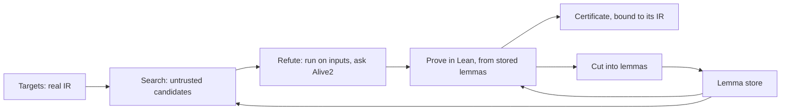
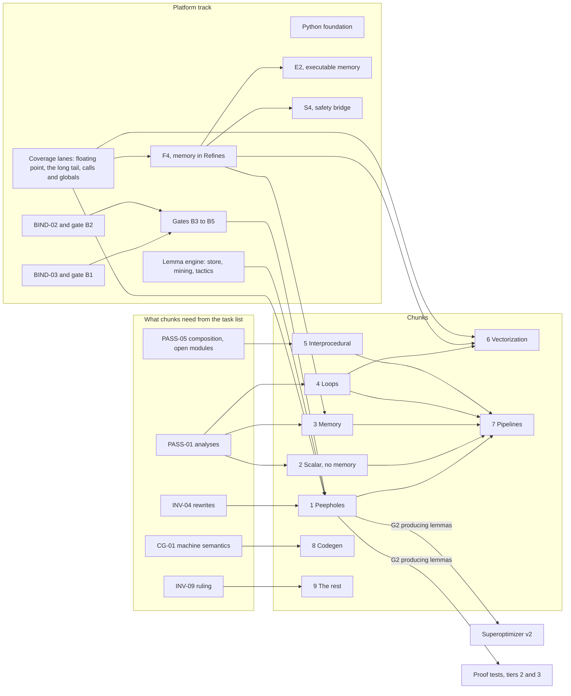
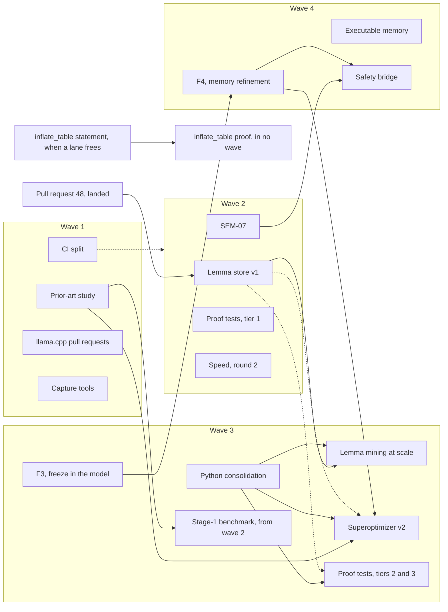

# Roadmap

What we want to be true of `ir-lean`, in what order, and how we'd know we were wrong. For what's true
today, see [status](status.md). For what any theorem means, see [trust](trust.md).

Nothing here is a date or a duration. Progress and order are gates and dependencies, as decided on
[2026-11-09](#six-decisions-of-2026-11-09-after-69). Effort figures, in lines of proof, are estimates that hold only if
the gates before them pass, and they get redone at each gate. Every threshold is a proposal, to adjust as we learn, but
any change gets written down here with its reason, so that a gate can't quietly move.

## The goal

**Prove LLVM's optimizations.** Since 2026-11-09 this is the main program
([decision 1](#six-decisions-of-2026-11-09-after-69)): every pass a pinned LLVM registers, 1,162 names at LLVM 23.1.3,
proved for every input, bound to the C++ that implements it, and correct in every pipeline it runs in, as the
[task list](llvm-verification-tasks.md) defines done. The passes are in nine [chunks](chunks.md), and each chunk goes
through from expressing its own regression tests to being counted done. A [platform track](#the-platform-track) runs under
all of them, and the chunks pull from it. The headline is the passes counted done, of the 1,162, with each chunk's
percentage at each gate. It's 0 today: a pass counts only when BIND-03, the independent verifier, accepts it, and that
verifier doesn't exist yet.

**Proved superoptimization and proof tests ride on the same platform.** Superoptimization finds code that's faster than
what the compiler produced, and proves in Lean that it refines the original: on every input, the new code does only
what the original allows. It starts with LLVM IR, brings MLIR in later by lowering it to LLVM IR, as
[multi-IR](multi-ir.md#recommendation) recommends, and GIMPLE after that, as a spike behind a gate. Neither it nor proof
tests is parked or dropped. They use the semantics, the lemma store and the engine the chunks use, and they get better
from the lemmas the chunks produce. Superoptimizer v2 and proof-test tiers 2 and 3 wait until chunk 1's G2 is producing
lemmas.

Four things serve both:

1. **A discovery engine and a lemma store.** The search finds candidates and their proofs. Every completed proof, a
   chunk's or the search's, leaves checked, reusable lemmas in a store, which makes the next search and the next proof
   cheaper, and makes `ir-lean` better. That loop is [the flywheel](#the-flywheel).
2. **Proof tests.** The same engine and store, asked whether code meets its spec rather than whether a candidate
   refines the original. See [one engine, two products](#one-engine-two-products).
3. **Guarantees.** Memory safety, and whole systems through contracts and frame reasoning. One theorem ties them to
   superoptimization, `Safe src → Refines src tgt → Safe tgt`, so optimized code inherits the source's safety proof.
   See [guarantees](#guarantees).
4. **Speed,** of the tool and of the dev cycle, as a goal in itself. See [Phase 8](#phase-8-speed).

Under all of it is **fidelity**: the LLVM IR to Lean translation and its semantics are faithful, and where they aren't,
the gap is written down, tested or refused. A proof about a pass's rewrites, or that a candidate refines the original,
is only as good as what the model says the source allows, so
[Phase 0](#phase-0-semantic-fidelity-and-trust-infrastructure) stays on the critical path.

All of these are statements about LLVM IR, and the [trust model](trust.md) says exactly what that does and doesn't
give you. Search tools and AI propose. Only a certificate the Lean kernel has checked counts.

### The goal changed on 2026-11-08

*Superseded in part on 2026-11-09, by [decision 1](#six-decisions-of-2026-11-09-after-69) after #69: proving LLVM's
optimizations is the main program again, and superoptimization rides on the same platform. What follows is the record
of 2026-11-08.*

Before 2026-11-08, this page put the foundation first. Its headline was zlib `inflate` proved memory-safe, as
[Phase 1](#phase-1-zlib-inflate-memory-safety), marked **Now**. Certified optimization was Phase 4, which wouldn't
begin until contracts were reused by three callers. Meanwhile, over 2026-11-07 and 2026-11-08, pull requests
[#42](https://github.com/phongndo/ir-lean/pull/42) to [#52](https://github.com/phongndo/ir-lean/pull/52) worked
toward something else: proving every optimization in a pinned LLVM, as the [task list](llvm-verification-tasks.md)
defines it. The two pages disagreed, and the work followed the task list.

On 2026-11-08 the maintainer settled it:

- The goal is proved superoptimization, with proof tests as a second product sharing its engine, as above.
- Proving every optimization in a pinned LLVM is parked as an end goal. Its tools stay, as tools for this goal. See
  [what's parked](#whats-parked-and-what-stays).
- `inflate` stops being the headline. It's the first target of the whole-system work, with Phase 2's contracts.
- Speed is a goal, with targets of its own.

Why:

- **A roadmap the work doesn't follow gates nothing.** This page's rule is that a gate can't move quietly, and for two
  days the real order lived somewhere else. Rewriting the page is how the change gets written down.
- **The strongest results so far are proved rewrites that make code faster.** [Two rewrites](llvm.md#beating-clang--o3)
  beat `clang -O3` and are proved to do the same, and a proved rewrite of llama.cpp's q4_K kernels reads prompts 5.5%
  to 7.2% faster ([lemma reuse](lemma-reuse.md)). Proved superoptimization makes that the product.
- **Proving every optimization pays only at its end.** It counts 1,162 registered names, with none done, and a pass is
  done only with proofs bound to LLVM's C++ and composed through every pipeline it runs in. Most of what it built on
  the way is what superoptimization needs anyway: a refinement relation, certificates bound to their inputs, gates
  that refuse wrong or unknown results, and rewrites proved at every width.
- **The dev cycle slowed as the work grew.** [Phase 8](#phase-8-speed) has the numbers.

These gates moved, or went:

| Gate | Was | Now | Why |
| --- | --- | --- | --- |
| When certified optimization starts | Phase 4 waited for contracts reused by three callers, after `inflate` | It's the goal. Each stage waits only on the fidelity work it needs, as [hard dependencies](#dependencies) | The old order put the foundation first, so certificates would rest on checked semantics. Integer code uses neither contracts nor `inflate`, and what loops and memory need, SEM-07, SEM-06 and the `undef` decision, stays a hard dependency |
| Phase 4's memory stage | Needed Phase 2's frame reasoning | Needs SEM-06. The frame lemmas it needs go in the lemma store, and Phase 2 generalizes from them later | Superoptimizer v2 rewrites one function at a time, so it needs lemmas about what that function's writes leave alone, not contracts across calls. If that proves wrong, this gate comes back |
| Reading Trivet and Lean-MLIR | Before stage 1 | Before superoptimizer v2's design, as a prior-art study in wave 1 | Stage 1 started with [#30](https://github.com/phongndo/ir-lean/pull/30), and no doc records reading Trivet. Doing it before the next design is the honest version |
| `inflate` | The headline, **Now** | Whole-system work: its first statement in wave 2, and its first proof in wave 3. Revised: the statement is light work, taken up when a lane frees ([wave 2](#wave-2-revised-on-2026-11-08)). Revised again on 2026-11-09: the proof is in no wave yet ([wave 3](#wave-3-set-on-2026-11-09)) | Superoptimization doesn't need it. It still matters, because its safety proof is what the bridge would carry to optimized code |
| Runtime memory model | Part of Phase 1 | [Phase 6](#phase-6-the-engine-and-the-lemma-store), in wave 2. Revised: wave 3 ([wave 2](#wave-2-revised-on-2026-11-08)). Revised again on 2026-11-09: wave 4 ([wave 3](#wave-3-set-on-2026-11-09)) | Every track that runs memory code needs it, not only `inflate` |
| Milestones | M0 to M11 | Named by phase: F, S, E, T, C, G, B and A | The old M1 to M4, for `inflate`, are G2 to G5 |

### Three decisions of 2026-11-09

On 2026-11-09 the maintainer decided three things this page had left open or hadn't said.

**1. `undef` stays out of the model, and `freeze` goes in.** `undef` constants stay refused, and reading
uninitialized memory stays poison, as the [known gaps](trust.md#known-gaps-in-the-model) list them. `freeze` enters the
model as [#49](https://github.com/phongndo/ir-lean/pull/49)'s [prototype](undef-freeze.md) defines it: `freeze` of a
value is that value, and `freeze` of poison is an arbitrary value of its type, the same for every use of that `freeze`,
chosen when it runs. F3 becomes "`freeze` in the model, with `undef` kept out", and F4, `Refines` for functions with
memory, depends on it.

Why:

- **It follows LLVM.** LLVM is moving to remove `undef`, with a byte type and a freezing load
  ([PLDI 2026](https://web.ist.utl.pt/nuno.lopes/pubs/byte-type-pldi26.pdf)), and Vellvm 3.0 already removed it
  ([prior art](prior-art.md)). Taking `undef` into the model would change the type of every emitted function, and every
  proof, for a value LLVM is retiring.
- **`freeze` stays in LLVM, and the model's stop at it costs refinements now.** No certificate covers a source that
  freezes poison, and inserting a `freeze`, which is right in LLVM, isn't a refinement in the model
  ([refinement](refinement.md#what-it-says-about-llvm)).
- **What `undef` leaves out is already written down.** Refusing `undef` constants is sound. Reading uninitialized memory
  as poison is more undefined behavior than LLVM has, which is fine for safety proofs and wrong for a refinement's
  source, so F4 has to settle it for memory.

**2. Proving every LLVM optimization stays parked**, as [below](#whats-parked-and-what-stays). Its progress metric is
the share of InstCombine's own test transformations that `ir-lean` can certify, which the stage-1 benchmark, S1,
measures.

Why: a parked goal still needs a number, so that bringing it back is a decision made on evidence. S1 is built to read
InstCombine's tests through the emitter and certify them, so the number comes from work already in a wave.

*Superseded later on 2026-11-09, by [decision 1](#six-decisions-of-2026-11-09-after-69) after #69: proving LLVM's
optimizations is the main program, and S1's metric is chunk 1's G1.*

**3. Python is the glue.** Python runs tools, reads their output and orchestrates processes. Anything that shows memory
or speed problems moves to C++, as the emitter is. Wave 3 starts with Python consolidation, as the foundation the rest
of it builds on, and the waves are reordered, in [wave 3](#wave-3-set-on-2026-11-09) and [wave 4](#wave-4). Later that
day, chunks and gates replaced the waves, and Python consolidation became the platform track's foundation
([decision 2](#six-decisions-of-2026-11-09-after-69)).

Why:

- **Python has grown with every lane.** At `3d7bffb`, `tools/` and `tests/` held 45 Python files, 23,845 lines.
  Consolidating first means wave 3's lanes build on one library instead of copying each other's.
- **Python has already shown both problems.** `tools/binding.py` read whole files to hash about 2.8 GiB of toolchain,
  at about 455 MiB a verify, as [wave 0](#wave-0-the-maintainer-now) records, and [Phase 8](#phase-8-speed) puts speed
  among the goals.

### Six decisions of 2026-11-09, after #69

Later on 2026-11-09, after [#69](https://github.com/phongndo/ir-lean/pull/69) recorded the three above, the maintainer
decided six more things. Where they replace something on this page, the old text stays, marked as superseded.

**1. Proving LLVM's optimizations is the main program.** This supersedes #69's
[decision 2](#three-decisions-of-2026-11-09), that the goal stays parked.

- Superoptimization isn't parked or dropped. It rides on the same platform, the semantics, the lemma store and the
  engine, and gets better from what the chunks produce.
- The headline measure is the passes counted done, of the 1,162, with a percentage for each chunk at each gate. A pass
  counts as done when BIND-03, the independent verifier, accepts it.
- S1's metric, the share of InstCombine's own test transformations certified, becomes chunk 1's G1.

Why:

- **The headline moves off 0% sooner.** Until now nothing counted until the whole stack existed. A chunk pushes a few
  passes through every gate.
- **The riskiest piece gets tested early, on a small chunk.** That's binding proofs to the C++, which
  [#74](https://github.com/phongndo/ir-lean/pull/74) chose a route for, with
  [gates and stop rules](binding-approach.md#gates).
- **Lemmas compound.** The peepholes go first because they build the library the next chunks use.
- **Chunks run in parallel,** at different gates.

**2. Chunks and gates replace waves.** [Waves 0 to 3](#waves-0-to-3-until-2026-11-09) stay as history. Wave 4's items,
E2, F4 and S4, move into the [platform track](#the-platform-track).

| Gate | Meaning |
| --- | --- |
| G0 Coverage | The model can express the chunk's own regression tests |
| G1 Instances | Its test transformations are certified |
| G2 All inputs | Every rewrite is proved for every input, and stored as lemmas |
| G3 Bound | Tied to its C++, by BIND's rule |
| G4 Composed | Correct in its pipelines. Then it counts as done |

| # | Chunk | Passes | Needs from the platform |
| --- | --- | --- | --- |
| 1 | Peepholes | InstSimplify, InstCombine, AggressiveInstCombine, Reassociate | INV-04, `freeze` (done), every-width proofs, floating point and external calls for coverage. Its smallest pass is the first try at BIND-06 |
| 2 | Scalar, no memory | SCCP, CorrelatedValuePropagation, ADCE and BDCE, SimplifyCFG, JumpThreading, DivRemPairs, ConstraintElimination | Sound dominators, known bits and lazy value info (PASS-01) |
| 3 | Memory | SROA, mem2reg, EarlyCSE, GVN and NewGVN, DSE, MemCpyOpt | Memory in `Refines` (SEM-06), sound alias analysis and MemorySSA |
| 4 | Loops | loop-simplify, LCSSA, rotate, LICM, IndVarSimplify, unroll, deletion, LSR | Sound scalar evolution. SEM-07 (done) |
| 5 | Interprocedural | Inliner, function-attrs, GlobalOpt, IPSCCP, ArgPromotion, DeadArgElim, devirtualization, ThinLTO | Composition, open modules |
| 6 | Vectorization | LoopVectorize and VPlan, SLP, the load-store vectorizer | Floating point, memory, chunk 4 |
| 7 | Pipelines | Composition across `O0` to `O3` and the LTO pipelines | Chunks 1 to 5 for `O1`'s passes, then `O2` and `O3` |
| 8 | Codegen | Selection, legalization, machine passes, then one target at a time: X86, AArch64 and RISC-V first, then AMDGPU and the rest | A machine-level semantics for each target |
| 9 | The rest | The 129 printers, verifiers and debug aids, and the 36 instrumentation passes | A ruling on what "proved" means for each kind (INV-09) |

Every one of the 1,162 registered passes belongs to exactly one chunk, analyses included. A test checks the assignment
against INV-01's inventory, and fails when a pass is unassigned or assigned twice. [Chunks](chunks.md) has each chunk's
passes, the platform work each gate needs, how each gate's percentage is measured, and the test.

**3. The platform track.** Chunks pull from it.

- **Python foundation:** finishing. Tests are moving onto the library, and the ratchet lint is next.
- **Semantics coverage.** Now: floating point (SEM-05), the long tail (SEM-08 and the remaining refusals), and external
  calls and globals. Next: F4, memory in `Refines` (SEM-06). Then E2 and the safety bridge, S4, after F4.
- **Lemma engine:** the store (E1, done), mining at scale (E3, now chunk 1's G2), and the tactics (AUTO-01 to 03).
- **Binding:** BIND-01 is done ([#74](https://github.com/phongndo/ir-lean/pull/74)). BIND-03, gate B1, and BIND-02
  toward gate B2 are the work now. B3 to B5 follow #74's gates and stop rules.
- **Honesty and speed:** the NEG tasks, and CI (C1).

**4. Several semantics lanes at once.** Each runs on its own module, and they merge one at a time. This replaces the
[limit](#limits) of one pull request at a time that changes semantics.

Why:

- **Coverage is the largest gap.** G0 for InstCombine was 38.4% on stage-1's run before F3: 12,002 of 31,240 changed
  test pairs translate.
- **The refusals split cleanly by feature.**
- **Merging one at a time keeps the old rule's safety.** Each lane is re-checked against the others before it merges.
- **The lane cap becomes each machine's heavy-job pool,** from [#75](https://github.com/phongndo/ir-lean/pull/75). z has
  32 cores and 30 GB, and y is a Mac with 64 GB.

**5. Deferred and folded in.**

- Superoptimizer v2, S3, and proof-test tiers 2 and 3, T2, wait until chunk 1's G2 is producing lemmas. Both prove from
  stored lemmas.
- Lemma mining at scale, E3, becomes chunk 1's G2 burn-down.
- F4 is next in the semantics stream, and starts when the first coverage lane lands.

**6. No calendar estimates in the plan.** Progress and order are gates and dependencies. A search of the docs on
2026-11-09 found no estimate in weeks, months or years left in the plan to remove. A run time that was measured is a
fact, and stays. No reason was given beyond the rule itself, which is the one the [milestones](#milestones) already
followed: each is reached when its checks pass in CI, not on a date.

### The flywheel



Targets come from real IR: code real programs spend time in, and the [corpus](corpus.md) of `opt`'s rewrites that
[#54](https://github.com/phongndo/ir-lean/pull/54) captures. The search proposes
candidates, which are untrusted. Most die cheaply, on concrete inputs or in Alive2. A survivor goes to Lean, which
starts from the lemmas in the store. A completed proof gives a certificate, [bound](llvm-proof-binding.md) to its IR
and toolchain, and is cut into lemmas, as [lemma reuse](lemma-reuse.md) prototypes. The ones that meet the bar below go
in the store, where they make the next proof shorter and tell the next search which shapes are already proved.

The store isn't trusted: a lemma is checked again wherever it's used. The bar is about whether it's worth keeping.

**The bar for a lemma,** proposed:

| Rule | Why | Shown today by |
| --- | --- | --- |
| Checked by the kernel, with only the standard axioms | Every later proof that uses it inherits what it rests on, so it can't carry `sorry` or `bv_decide`'s native-code axiom into them | `tests/check_axioms.lean` and `leanchecker` on each module holding a stored lemma, through `tools/store/store.py check` ([lemma store](lemma-store.md)) |
| Stated for every width where that makes sense | A lemma at 32 bits doesn't help at 64. The q4_K store needed two core lemmas for its two widths | The 33 rewrites [#48](https://github.com/phongndo/ir-lean/pull/48) proves at every width, in [`IRLean/Generic`](../IRLean/Generic). `store.py check` refuses a width written as a number other than 1 |
| Each hypothesis shown necessary by a counterexample | A hypothesis nothing needs makes a lemma apply less often than it could | [`RewriteCounter.lean`](../tests/generic_rewrites/RewriteCounter.lean), from #48, and for the store, a theorem in [`store/LemmaStore/Counter`](../store/LemmaStore/Counter) for each hypothesis, which `store.py check` checks states the lemma without it |
| Reused by at least 2 proofs | A lemma one proof uses is that proof's step, not a library | `store.py check` counts the proofs that use each stored lemma. None of #48's rewrites has two yet |

A lemma that meets the first three can wait in the store as a candidate, and counts once a second proof uses it. One
consequence: a lemma only `bv_decide` proves, such as the prototype's steps for population counts, doesn't qualify
until it's proved without it.

### One engine, two products

| | Superoptimization | Proof tests |
| --- | --- | --- |
| Proves | A candidate refines the original | Code meets its spec |
| The spec | The original code | A property the developer writes |
| Searches for | Candidates, then their proofs | Counterexamples, then a proof |
| A failure is | A refuted candidate, thrown away | A counterexample, shown to the developer |
| Shares | Tiered checking, the lemma store, certificates, and the gates that refuse wrong, unknown or stale results | The same |

**Proof tests** aim to move software engineering from unit and end-to-end tests toward proofs, which cover every input
rather than the few an assert names. A proof test escalates, and never reports a pass it hasn't earned:

- **Tier 1:** run the property on random and edge-case inputs, for a concrete counterexample in milliseconds, as
  property-based testing gives.
- **Tier 2:** a bounded proof, with `bv_decide` or small loop bounds.
- **Tier 3:** a full proof, from stored lemmas.

It reports a pass at tier N, a counterexample, or unknown, and never reports unknown as a pass. A pass at tier 1 says
no counterexample was found. Tiers 2 and 3 are proofs, and tier 2's holds only within its bounds.

The first convincing milestone: replace one real project's unit-test file with proof tests that catch every injected
bug the unit tests catch, and more, in comparable time. [Phase 7](#phase-7-proof-tests) has the details, and where
this sits beside Hypothesis, QuickCheck, Kani, CBMC, Dafny and Verus.

### Guarantees

- **Memory safety.** zlib's `updatewindow` is [proved memory-safe](memory.md)
  ([#37](https://github.com/phongndo/ir-lean/pull/37)). `inflate`, [Phase 1](#phase-1-zlib-inflate-memory-safety), is
  the whole-system track's first target. Its milestones haven't started.
- **Whole systems.** Contracts and frame reasoning, so a caller's proof doesn't look inside its callees.
  [Phase 2](#phase-2-reusable-contracts-and-frame-reasoning).
- **The bridge.** `Safe src → Refines src tgt → Safe tgt`, in
  [Phase 4](#phase-4-certified-translation-validation-and-superoptimization). It needed SEM-07 first, so a target can't
  claim a promise no certificate checked, and SEM-07 landed in [#62](https://github.com/phongndo/ir-lean/pull/62). It
  also needs `Refines` for functions with memory, which [doesn't exist yet](refinement.md). That's SEM-06, F4, next in
  the [platform track](#the-platform-track)'s semantics stream, now that F3 has landed.

### What's parked, and what stays

*Superseded on 2026-11-09, by [decision 1](#six-decisions-of-2026-11-09-after-69) after #69: nothing here is parked.
Proving every optimization is the main program, in [chunks](chunks.md), and the task list is its plan again, not only a
reference. The tools in the table below are still kept, and they're the platform's now. What follows is the record from
2026-11-08 to then.*

**Parked as an end goal:** proving every optimization in a pinned LLVM. That covers the count of 1,162 registered pass
names, the `O1` obligation ledger from #52, and binding proofs to LLVM's C++, BIND-02 to BIND-05 in the task list. The
[task list](llvm-verification-tasks.md) stays as a reference inventory, with its statuses kept true, and
`tests/llvm_scope.py check` still checks it. It comes back as a goal only by a change written down here, with its
reason. Its progress metric, since [2026-11-09](#three-decisions-of-2026-11-09), is the share of InstCombine's own test
transformations that `ir-lean` can certify, which S1 measures.

**Kept, as tools for the goal:**

| Tool | From | What it does for the goal |
| --- | --- | --- |
| `IRLean.Refines` and its laws | [#46](https://github.com/phongndo/ir-lean/pull/46), [refinement](refinement.md) | The statement every certificate proves, and transitivity and composition, so certified steps chain |
| Certificate binding | [#45](https://github.com/phongndo/ir-lean/pull/45), [binding](llvm-proof-binding.md) | Ties a certificate to its IR, pass run and toolchain, and checks it again from scratch |
| Gates that refuse wrong, unknown or stale results | [#44](https://github.com/phongndo/ir-lean/pull/44), [#50](https://github.com/phongndo/ir-lean/pull/50), [negative verification](llvm-negative-verification.md), [replay challenge](replay-challenge.md) | A candidate or a proof test can't pass on a wrong rewrite, a timeout or a stale result |
| Alive2 cross-checks | `tests/opcheck.py`, `tests/gepcheck.py`, #50 | A second opinion on the semantics, and a cheap refuter |
| Rewrite lemmas at every width | #48, [generic rewrites](generic-rewrites.md) | The lemma store's first seed |
| `O1` run capture | #52, slimmed down in [#54](https://github.com/phongndo/ir-lean/pull/54), [corpus](corpus.md) | A corpus of real IR for the search, and of rewrites to cut lemmas from |

### Which IRs, and which languages

In the order we validate them. Other front ends may produce IR that translates, but we make no claims about them and
spend no effort on them until these work.

| Order | Input | Status | Where it gets validated |
| --- | --- | --- | --- |
| 1 | LLVM IR from C | Three proofs against clang's `-O2` output including real zlib, 46 functions from compiler-rt, and superoptimizer v1 | Every phase |
| 2 | LLVM IR from C++ and Rust | 41 C++ functions from LLVM Support and `llvm-libc` ([LLVM's own code](llvm.md)), and [small probes](status.md#probes-for-later-phases) | [Phase 3](#phase-3-c-and-rust-demonstrations) |
| 3 | MLIR, lowered and exported to LLVM IR | [A design note and prototype](multi-ir.md) only | [Phase 4](#phase-4-certified-translation-validation-and-superoptimization), after superoptimizer v2 |
| 4 | GIMPLE | A hand-transcribed [prototype](multi-ir.md#the-prototype) only | A spike, behind the gate in Phase 4 |

### What this project won't do

- Claim that a C, C++ or Rust source program is verified. That needs a proof about the front end's
  lowering, which we don't have and don't plan.
- Claim anything about machine code without a correspondence argument, which we don't have.
- Compile general Lean 4 programs to LLVM IR. See [IR and Lean, both ways](design.md#ir-and-lean-both-ways).
- Trust an AI's output. AI provers and search tools are welcome, and nothing they produce counts until
  the Lean kernel has checked it and a person has read the theorem statement.
- Report a proof test's tier-1 pass as a proof, or a timeout or an unsupported case as a pass.
- Call an LLVM pass correct because its runs were certified. That's translation validation, which
  [never counts for all inputs](llvm-verification-tasks.md#translation-validation-isnt-proof-for-all-inputs).
- Count a pass as done before an independent verifier, BIND-03, has accepted its claims. A claim's own status and
  hashes are its author's word.

## Now, next, later

| Horizon | Platform track | Chunks |
| --- | --- | --- |
| **Now** | Semantics lanes for floating point (SEM-05), the long tail (SEM-08 and the remaining refusals), and external calls and globals, whose design is in [#81](https://github.com/phongndo/ir-lean/pull/81), open. The binding verifier, BIND-03, with gate B1, and BIND-02 toward gate B2 | Chunk 1: S1 finishing, then G0 and G1 across its four passes. INV-04, in [#79](https://github.com/phongndo/ir-lean/pull/79), open, and the G2 burn-down |
| **Next** | F4, memory in `Refines` (SEM-06), when the first coverage lane lands. Binding gates B3 to B5, by [#74's gates and stop rules](binding-approach.md#gates). The tactics, AUTO-01 to 03 | Chunk 1 through G2 and G3, to its first pass done, BIND-06. The other chunks start at G0 as what they need from the platform lands. Superoptimizer v2 and proof-test tiers 2 and 3, once chunk 1's G2 is producing lemmas |
| **Later** | E2, the executable memory model, and the safety bridge, S4, after F4 | Chunks 2 to 9 through their gates. MLIR, `inflate`, contracts, C++ and Rust, the unit-test milestone, and adoption, which wait on milestones or [aren't in the plan's order yet](#not-in-the-plans-order-yet) |

**Done on 2026-11-09:** F3, `freeze` in the model ([#72](https://github.com/phongndo/ir-lean/pull/72)), BIND-01
([#74](https://github.com/phongndo/ir-lean/pull/74)), and the shared Python library, `tools/irlean`, with `tools/` and
`tests/` on it, and the ratchet lint that keeps them there ([#70](https://github.com/phongndo/ir-lean/pull/70),
[#71](https://github.com/phongndo/ir-lean/pull/71), [#73](https://github.com/phongndo/ir-lean/pull/73),
[#75](https://github.com/phongndo/ir-lean/pull/75), [#76](https://github.com/phongndo/ir-lean/pull/76),
[#77](https://github.com/phongndo/ir-lean/pull/77) and [#78](https://github.com/phongndo/ir-lean/pull/78)).

## Next steps

Since 2026-11-09 the order is the platform track and the chunks
([decision 2](#six-decisions-of-2026-11-09-after-69)). Chunks run in parallel, each at its own gate, and an item starts
when its own [hard dependencies](#dependencies) have landed. The [waves](#waves-0-to-3-until-2026-11-09) before that
are history.



Every arrow is a hard dependency, of the gate it's needed for: F4 holds up chunk 3 from G1 on, PASS-01 holds up a
chunk's G2, and the binding gates hold up G3. A chunk can reach G0 and G1 before the rest of what it needs lands.

### The platform track

Chunks pull from it ([decision 3](#six-decisions-of-2026-11-09-after-69)).

- **Python foundation.** Done: the shared library, `tools/irlean`, with `tools/` and `tests/` on it, in #70, #71,
  #73, #75, #76 and #77, and the ratchet lint, in #78, which bans running processes and hashing outside the library
  ([Python](python.md)).
- **Semantics coverage.** Done: SEM-07, in [#62](https://github.com/phongndo/ir-lean/pull/62), and F3, in #72. Now:
  floating point, SEM-05, the long tail, SEM-08 and the remaining refusals, and external calls and globals, as several
  lanes at once, each on its own module, merged one at a time ([limits](#limits)). Next: F4, memory in `Refines`,
  SEM-06, which starts when the first coverage lane lands. Then E2, the executable memory model, and the safety bridge,
  S4, after F4.
- **Lemma engine.** Done: the store, E1, in [#60](https://github.com/phongndo/ir-lean/pull/60). Mining at scale, E3, is
  chunk 1's G2 burn-down. The tactics are AUTO-01 to 03: AUTO-01 and AUTO-03 are in progress, and AUTO-02 hasn't
  started ([task list](llvm-verification-tasks.md#auto-01-the-refinement-tactic)).
- **Binding.** Done: BIND-01 and gate B0, in #74 ([binding a proof to LLVM's C++](binding-approach.md)). Now: BIND-03,
  the independent verifier, with gate B1, and BIND-02, each pass's closure, toward gate B2. Then gates B3 to B5, by
  [#74's gates and stop rules](binding-approach.md#gates). B5 is BIND-06, the first pass done end to end.
- **Honesty and speed.** The NEG tasks, NEG-02 to NEG-07, which keep wrong and unknown results from counting, and C1,
  pull request CI in at most 10 minutes ([Phase 8](#phase-8-speed)).

### The chunks, at their gates

[Chunks](chunks.md) has each chunk's passes, how each gate is measured, and the numbers.

| # | Chunk | Where it is | What it waits on next |
| --- | --- | --- | --- |
| 1 | Peepholes | S1 finishing. G0 measured once for InstCombine, 38.4%. Nothing else measured | S1's G1 for InstCombine. INV-04 for G2. The binding gates for G3 |
| 2 | Scalar, no memory | Nothing measured | PASS-01's dominators, known bits and lazy value info |
| 3 | Memory | Nothing measured | F4, and sound alias analysis and MemorySSA |
| 4 | Loops | Nothing measured | Sound scalar evolution |
| 5 | Interprocedural | Nothing measured | Composition and open modules |
| 6 | Vectorization | Nothing measured | Floating point, F4 and chunk 4 |
| 7 | Pipelines | Nothing measured | Chunks 1 to 5 for `O1`'s passes. At the pin, `O1` also runs three of chunk 6's passes and six of chunk 9's ([chunks](chunks.md#7-pipelines)) |
| 8 | Codegen | Nothing measured | CG-01, for X86, AArch64 and RISC-V first |
| 9 | The rest | Nothing measured | INV-09's ruling on what "proved" means for each kind |

### Waves 0 to 3, until 2026-11-09

*Replaced on 2026-11-09 by the platform track and the chunks, [decision 2](#six-decisions-of-2026-11-09-after-69). This
is the record of the waves as they stood. Items in one wave ran in parallel, and an item in a later wave started when
its own hard dependencies had landed.*



Solid arrows are hard dependencies and dashed ones soft. F4 holds up only superoptimizer v2's memory candidates, not
the rest of it.

#### Wave 0: the maintainer, now

- Merge [#48](https://github.com/phongndo/ir-lean/pull/48), which was green. Done.
- Close [#52](https://github.com/phongndo/ir-lean/pull/52), done, and replace it with a slim pull request of its
  capture and measurement tools, in wave 1. Done in [#54](https://github.com/phongndo/ir-lean/pull/54).
- File the 4 bugs #52 found in other lanes' code, as issues:
  - `tools/binding.py` reads whole files to hash about 2.8 GiB of toolchain on every verify, which costs about 455 MiB.
  - `tools/binding.py`'s `willreturn` check covers the whole module, so an intrinsic's declaration blocks a step whose
    function promises nothing. Fixed by SEM-07 in [#62](https://github.com/phongndo/ir-lean/pull/62): the model checks promises, so the check is gone.
  - `tests/verify_negative.py` misreads memory on macOS: it divides `ru_maxrss` by 1024, and its free-memory guard
    reads only `/proc/meminfo`.
  - `tests/llvm_scope.py check` fails on macOS, because 12 of `llc`'s target pipelines depend on the host.
- Delete merged branches.

#### Wave 1, all in parallel

- This roadmap. Done in [#55](https://github.com/phongndo/ir-lean/pull/55).
- Split CI into parallel jobs. Done in [#53](https://github.com/phongndo/ir-lean/pull/53). [Phase 8](#phase-8-speed) has the
  target, which it doesn't reach yet.
- Bring the two llama.cpp branches to `main` as pull requests. Done:
  - `feat/prove-llvm-optimization-1`, in [#57](https://github.com/phongndo/ir-lean/pull/57) (`b59d862`): the q4_K
    VNNI rewrite, proved at all 34 places, reads prompts 5.5% to 7.2% faster.
  - `feat/prove-llvm-optimization`, in [#58](https://github.com/phongndo/ir-lean/pull/58): a Q5 rewrite, measured on
    real inference. [Its page](llama-q5.md) gives a median inference speedup of 1.049 times on one thread, with a 95%
    interval of 1.029 to 1.057.
- A prior-art study for superoptimization and proof tests. It gates superoptimizer v2's design. Done in
  [#56](https://github.com/phongndo/ir-lean/pull/56), as [prior art](prior-art.md), which also answers
  [the Phase 4 gate](prior-art.md#the-gate).
- The slim pull request of #52's capture and measurement tools. Done in #54.

#### Wave 2, revised on 2026-11-08

It waited on #48 and the CI split, which landed in #48 and #53. Five lanes:

- Lemma store v1, E1, slice 22, [Phase 6](#phase-6-the-engine-and-the-lemma-store). Done in
  [#60](https://github.com/phongndo/ir-lean/pull/60).
- The stage-1 benchmark and soundness corpus, S1, slice 29, [Phase 4](#phase-4-certified-translation-validation-and-superoptimization):
  InstCombine's own rewrites certified with `bv_decide` at fixed widths, compared with Alive2, and a corpus of known
  miscompilations, none of which may get a certificate.
- SEM-07, F2, slice 23: breaking `mustprogress` or `willreturn` is UB, as in LangRef,
  [Phase 0](#phase-0-semantic-fidelity-and-trust-infrastructure).
  Done in [#62](https://github.com/phongndo/ir-lean/pull/62).
- Tier-1 proof tests on `tools/verify.py`, T1, slice 24, [Phase 7](#phase-7-proof-tests). Done in
  [#66](https://github.com/phongndo/ir-lean/pull/66).
- Speed, round 2, C1, slice 30, [Phase 8](#phase-8-speed). [#61](https://github.com/phongndo/ir-lean/pull/61),
  [#63](https://github.com/phongndo/ir-lean/pull/63), [#64](https://github.com/phongndo/ir-lean/pull/64) and
  [#65](https://github.com/phongndo/ir-lean/pull/65) landed, and #65's last pull request run, with the other three
  merged in, took 8.0 minutes.

The statement of `inflate_table`'s theorem, Z1, slice 13, isn't a lane. It's light work, taken up when one of these
frees.

S1 hadn't finished when wave 3 was set, on 2026-11-09, and finishes there.

**What changed.** On 2026-11-08 the maintainer approved this wave in place of the one #55 wrote, which was lemma store
v1, SEM-07, the executable memory model, tier-1 proof tests, and `inflate_table`'s statement:

| Item | Was | Now | Why |
| --- | --- | --- | --- |
| Stage-1 benchmark, S1 | In no wave | Wave 2 | [The gate's answer](prior-art.md#the-gate) made it actionable, and narrower: neither covers stage 1, so it goes ahead, as the four things nobody has shipped, and without an LLM proof pipeline or width-generic procedure of our own |
| Speed, round 2, C1 | In no wave, after #53's split | Wave 2 | C1 is open: CI takes 13 to 16 minutes against its 10, and [Phase 8](#phase-8-speed) puts getting back under 10 before adding tests, which every lane in this wave does |
| Executable memory model, E2 | Wave 2 | Wave 3 | Two [limits](#limits). Only one pull request at a time changes semantics in `IRLean/*.lean`, and in wave 2 SEM-07 holds it. And the five lanes above fill the cap of about 4 or 5 |
| `inflate_table`'s statement, Z1 | Wave 2 | Light work, when a lane frees | The five lanes fill the cap. It's a statement for review, with no proof |

#### Wave 3, set on 2026-11-09

Python consolidation is the foundation, [decision 3](#three-decisions-of-2026-11-09).

**First:**

- Python consolidation, slice 31, [Phase 8](#phase-8-speed): one shared library for `tools/` and `tests/*.py`, with
  anything that shows memory or speed problems moved to C++.
- `freeze` in the model, with `undef` kept out, F3, slice 32, [Phase 0](#phase-0-semantic-fidelity-and-trust-infrastructure).
  It's the one lane that changes semantics in `IRLean/*.lean` this wave. Done in [#72](https://github.com/phongndo/ir-lean/pull/72).
- The stage-1 benchmark finishing, S1, slice 29, [Phase 4](#phase-4-certified-translation-validation-and-superoptimization),
  from wave 2.

**Then, on that foundation:**

- Lemma mining at scale, E3, slice 33, [Phase 6](#phase-6-the-engine-and-the-lemma-store), with targets for peak memory
  on big proofs.
- Superoptimizer v2, S3, slice 25: more arguments, `select`, memory, and real targets,
  [Phase 4](#phase-4-certified-translation-validation-and-superoptimization). Its memory candidates wait on F4.
- Proof-test tiers 2 and 3, T2, slice 27, [Phase 7](#phase-7-proof-tests).

**What changed,** against the wave 3 that [wave 2's revision](#wave-2-revised-on-2026-11-08) left:

| Item | Was | Now | Why |
| --- | --- | --- | --- |
| Python consolidation | In no wave | Wave 3, first | Decision 3: it's the foundation the rest of wave 3 builds on |
| F3, `freeze` in the model | In no wave, waiting on the `undef` decision | Wave 3, first | Decision 1 made it, and F4 waits on F3 |
| S1, the stage-1 benchmark | Wave 2 | Finishes in wave 3, first | It hadn't finished, and decision 2 makes it the parked goal's measure too |
| Lemma mining at scale, E3 | In no wave | Wave 3, then | The maintainer's order. E1 landed in [#60](https://github.com/phongndo/ir-lean/pull/60), and E3 is what shows the store pays |
| Superoptimizer v2, S3, and proof-test tiers 2 and 3, T2 | Wave 3 | Wave 3, then | They build on Python consolidation |
| The executable memory model, E2 | Wave 3 | [Wave 4](#wave-4) | The maintainer's order puts it with the rest of the memory work, F4 and S4 |
| The safety bridge, S4 | Wave 3 | Wave 4 | It needs F4, which needs F3, so it can't land in wave 3 |
| The unit-test milestone, T3, slice 28 | Wave 3 | [In no wave](#not-in-the-plans-order-yet) | Not in the maintainer's order. It waits on T2 |
| The `inflate_table` proof, slice 14 | Wave 3 | In no wave | Not in the maintainer's order, and it waits on 0A's slices 6 and 7, which aren't in a wave either |

**What changed later on 2026-11-09,** after #69, when chunks and gates replaced the waves:

| Item | Was | Now | Why |
| --- | --- | --- | --- |
| Python consolidation | Wave 3, first | The platform track's Python foundation, finishing | [Decision 3](#six-decisions-of-2026-11-09-after-69) |
| S1, the stage-1 benchmark | Wave 3, first, finishing | Chunk 1, finishing. Its metric is chunk 1's G1 for InstCombine | Decision 1 |
| Lemma mining at scale, E3 | Wave 3, then | Chunk 1's G2 burn-down | Decision 5 |
| Superoptimizer v2, S3, and proof-test tiers 2 and 3, T2 | Wave 3, then | Deferred until chunk 1's G2 is producing lemmas | Decision 5: both prove from stored lemmas |
| F4, memory refinement | Wave 4 | The platform's semantics stream, next: it starts when the first coverage lane lands | Decision 5 |
| The executable memory model, E2, and the safety bridge, S4 | Wave 4 | The platform's semantics stream, after F4 | Decisions 2 and 3 |

#### Wave 4

*Moved into the platform track on 2026-11-09, [decision 2](#six-decisions-of-2026-11-09-after-69): E2 and S4 after F4,
and F4 next in the semantics stream.*

- The executable memory model, E2, slice 15, [Phase 6](#phase-6-the-engine-and-the-lemma-store). Moved from wave 2 to
  wave 3 on 2026-11-08, [above](#wave-2-revised-on-2026-11-08), and to wave 4 on 2026-11-09.
- `Refines` for functions with memory, F4, SEM-06, slice 34, [Phase 0](#phase-0-semantic-fidelity-and-trust-infrastructure).
  It waits on F3.
- The safety bridge, S4, slice 26, [Phase 4](#phase-4-certified-translation-validation-and-superoptimization). It waits
  on F4.

### Dependencies

**Hard:** the second doesn't start until the first has landed.

| First | Then | Why |
| --- | --- | --- |
| #48 | Seeding the lemma store | Its rewrites at every width are the seed. Met: #48 landed |
| The prior-art study | Superoptimizer v2's design | The field is moving: [Trivet](https://arxiv.org/abs/2609.19583) already does LLM-assisted refinement proofs in Lean on integer code. This is the reading the old Phase 4 asked for before stage 1. Met: #56 landed |
| SEM-07 | The safety bridge | While `mustprogress` and `willreturn` are trusted, a target can claim a promise the certificate didn't check, and the bridge would carry safety to it. Met: SEM-07 landed in [#62](https://github.com/phongndo/ir-lean/pull/62) |
| `inflate_table`'s statement, reviewed | Its proof | A proof of the wrong statement is wasted, and the statement is where a memory-safety claim is most likely to be wrong |
| Python consolidation | Lemma mining at scale, now chunk 1's G2, superoptimizer v2, and proof-test tiers 2 and 3 | They're built on its shared library, by [decision 3](#three-decisions-of-2026-11-09), so they don't add Python it would then have to move |
| F3, `freeze` in the model | F4, memory refinement | Decided on 2026-11-09. F3 changes what a run's outcome is, since `freeze` makes it a choice, and F4's relation between memories is stated over that outcome, so it's built once, on F3's. Met: F3 landed in [#72](https://github.com/phongndo/ir-lean/pull/72) |
| F4 | The safety bridge, E2, and superoptimizer v2's memory candidates | The bridge is a statement about `Refines` with memory, and so is every certificate for a memory candidate. E2 follows F4 by [decision 3](#six-decisions-of-2026-11-09-after-69) |
| The first coverage lane landing | F4 | [Decision 5](#six-decisions-of-2026-11-09-after-69) |
| Chunk 1's G2 producing lemmas | Superoptimizer v2, and proof-test tiers 2 and 3 | Decision 5: both prove from stored lemmas |
| A pair's G0, its two sides translating | Its G1 | A certificate is about the translated pair |
| INV-04's units for a pass | That pass's G2 | G2's percentage is over them, so without them there's nothing to count |
| A pass's G2 and G3, and the G2 of the analyses it reads | Its G4 | Done is all-input, code-binding and composition, by the [task list's rule](llvm-verification-tasks.md#translation-validation-isnt-proof-for-all-inputs), and composition is with the analyses a pass reads |
| BIND-03 | Any pass's G4 | A pass counts as done only when the independent verifier accepts it |
| BIND-02's closure, and the binding gates up to B4 | A chunk's G3 | G3's percentage is over the closure's functions, and binding code that changes IR is B4 |
| Floating point, SEM-05, and external calls and globals | Most of chunk 1's G0 | Coverage is chunk 1's gap ([decision 4](#six-decisions-of-2026-11-09-after-69)) |
| PASS-01: sound dominators, known bits and lazy value info | Chunk 2's G2 | Its rewrites rest on those facts |
| F4, and sound alias analysis and MemorySSA | Chunk 3's G1, and its G2 | Without memory in `Refines`, no claim about a function with memory can be stated |
| Sound scalar evolution | Chunk 4's G2 | Loop rewrites rest on its facts. SEM-07, the other need, landed in #62 |
| Composition and open modules | Chunk 5's G2 | A call out of a module is refused today |
| Floating point, F4, and chunk 4 | Chunk 6 | Vectorized code reads memory, reduces floats, and is loop code first |
| Chunks 1 to 5's G4 for `O1`'s passes | Chunk 7's G4 for `O1`, then `O2` and `O3` | A pipeline composes its passes' claims. At the pin, `O1` also runs three of chunk 6's passes and six of chunk 9's ([chunks](chunks.md#7-pipelines)) |
| CG-01 for a target | Chunk 8's G0 for that target | Machine passes need a machine-level semantics |
| INV-09's ruling for a kind | Chunk 9's G0 for that kind | What "proved" means for a printer or an instrumentation pass is written first |

**Soft:** better in this order. Going the other way needs a reason, written in the pull request.

| First | Then | Why |
| --- | --- | --- |
| The CI split | Wave 2's pull requests | They all add tests, and before the split CI took 37 to 38 minutes of its 60-minute limit. Met: #53 landed |
| Lemma store v1 | Superoptimizer v2, and proof-test tier 3 | Both prove from stored lemmas. Without the store, each would build its own |
| Chunk 1 | The other chunks' G2 | Lemmas compound: the peepholes build the library the next chunks use ([decision 1](#six-decisions-of-2026-11-09-after-69)) |
| The pass with the smallest closure | The rest of chunk 1's G3 | [#74](https://github.com/phongndo/ir-lean/pull/74) picks BIND-06's pass by the size of its closure, so the riskiest piece is tried on the least code |

### Not in the plan's order yet

Called "Not in a wave yet" until 2026-11-09. These are needed by something on the critical path, and neither the
platform track nor a chunk holds them yet. Where they go is the maintainer's call.

- **The `inflate_table` proof, slice 14,** moved out of wave 3 on 2026-11-09. Its statement, Z1, stays light work for
  when a lane frees.
- **The rest of 0A, slices 6 and 7.** Phase 1 needs 0A, so the `inflate_table` proof waits on them, as it did before.
  They land first, or the proof's pull request waives the gate with its reason.
- **The unit-test milestone, T3, slice 28,** moved out of wave 3 on 2026-11-09. It waits on T2.
- **The rest of Phase 0:** slices 8, 10, 12 and 16 [below](#near-term-pull-requests). Slice 12, semantic mutation, is
  NEG-03, in the platform track's honesty work.
- **Phases 2, 3 and 5,** which wait on milestones not reached yet.

Two items left this list earlier on 2026-11-09. The `undef` decision was made,
[decision 1](#three-decisions-of-2026-11-09), and SEM-06, memory refinement, is F4, now next in the platform track.

### Limits

- **Several semantics lanes at once, merged one at a time.** Since 2026-11-09, by
  [decision 4](#six-decisions-of-2026-11-09-after-69). Each lane changes its own module of the model, and before it
  merges it's checked again against `main` with every lane merged before it, so each change is still reviewed against
  what's on `main`. Every proof and certificate rests on those files, which is why they merge one at a time.
  *Until 2026-11-09 the limit was one pull request at a time that changes semantics in `IRLean/*.lean`:* two semantic
  changes at once couldn't each be reviewed against what's on `main`, and each one makes every proof check again. In
  wave 2 that was SEM-07, which is one reason the executable memory model moved to wave 3. In wave 3 it was F3, done in
  [#72](https://github.com/phongndo/ir-lean/pull/72).
- **As many lanes as each machine's heavy-job pool admits.** Since 2026-11-09 the cap is the pool
  [#75](https://github.com/phongndo/ir-lean/pull/75) made: `tools/measure.py run --heavy` takes a slot only while
  available memory allows ([corpus](corpus.md#measuring-a-heavy-job)). z has 32 cores and 30 GB, and y is a Mac with 64
  GB. Lean takes 1.5 to 3.5 GB a process: one binding verify peaked at 1.5 GiB in #52's pilot, and `CMakeLists.txt`
  runs the `binding` test alone because each of its Lean processes takes up to 3.5 GB. Every lane still registers its
  tests in `CMakeLists.txt`, where they conflict. *Until 2026-11-09 the cap was about 4 or 5 active lanes, because
  runners are limited.*

### Near-term pull requests

Small slices, each reviewable alone. Numbers are stable names, kept from earlier versions of this page.

Done: axiom allow-list ([#11](https://github.com/phongndo/ir-lean/pull/11)), Alive2 required and on the same LLVM
([#13](https://github.com/phongndo/ir-lean/pull/13)), model stops ([#14](https://github.com/phongndo/ir-lean/pull/14)),
GEP flags ([#15](https://github.com/phongndo/ir-lean/pull/15)), attribute and linkage allow-lists
([#16](https://github.com/phongndo/ir-lean/pull/16)), `-fno-strict-aliasing` and refusing `tbaa`
([#18](https://github.com/phongndo/ir-lean/pull/18)), and the promise model
([#19](https://github.com/phongndo/ir-lean/pull/19)).

| # | Slice | Phase | Wave | Done when |
| --- | --- | --- | --- | --- |
| 17 | Split CI into parallel jobs | 8 | 1 | Done in #53. C1 below is still open |
| 18 | The q4_K rewrite, from `feat/prove-llvm-optimization-1` | 4 | 1 | Done in #57: on `main`, its proofs checked in CI, and its benchmark reproducible from the repo |
| 19 | The Q5 rewrite, from `feat/prove-llvm-optimization` | 4 | 1 | Done in #58, the same way |
| 20 | Prior-art study for superoptimization and proof tests | 4, 7 | 1 | A note in `docs/` covering at least the work in [prior art](#prior-art), which superoptimizer v2's design cites |
| 21 | #52's capture and measurement tools, without its ledger | 4 | 1 | Done in #54: `tools/corpus/capture.py` and `tools/measure.py`. Reading the corpus is superoptimizer v2's |
| 22 | Lemma store v1 | 6 | 2 | E1 below |
| 23 | Promises as UB, SEM-07 | 0 | 2 | Done in [#62](https://github.com/phongndo/ir-lean/pull/62): a `loop-deletion` run under `mustprogress` is bound as a refinement, and adding the promise provably isn't one |
| 24 | Tier-1 proof tests on `tools/verify.py` | 7 | 2 | T1 below |
| 29 | Stage-1 benchmark and soundness corpus | 4 | 2, finishing in 3 | S1 below |
| 30 | Speed, round 2 | 8 | 2 | C1 below |
| 13 | Statement of `inflate_table`'s theorem, for review, with no proof | 1 | When a lane frees | Someone other than the author has reviewed it |
| 31 | Python consolidation | 8 | 3, first | `tools/` and `tests/*.py` share one library, and what showed memory or speed problems is in C++ |
| 32 | `freeze` in the model, with `undef` kept out | 0 | 3, first | F3 below. Done in [#72](https://github.com/phongndo/ir-lean/pull/72) |
| 33 | Lemma mining at scale | 6 | 3, then | E3 below, and targets for peak memory on big proofs, set in [Phase 8](#phase-8-speed) |
| 25 | Superoptimizer v2 | 4 | 3, then | S3 below |
| 27 | Proof-test tiers 2 and 3 | 7 | 3, then | T2 below |
| 15 | Executable memory representation, proved to agree with `Mem` | 6 | 4 | E2 below |
| 34 | `Refines` for functions with memory, SEM-06 | 0 | 4 | F4 below |
| 26 | The safety bridge | 4 | 4 | S4 below |
| 28 | One real project's unit-test file, as proof tests | 7 | None yet | T3 below |
| 14 | `inflate_table` proof | 1 | None yet | Checks in CI, costs recorded, and the 30:1 gate evaluated |
| 6 | Pin the target in `tests/zlib.sh`, as `tests/proofs.sh` already does | 0 | None yet | Generated IR's triple is the pinned one on any host |
| 7 | Write a manifest for each generated module | 0 | None yet | Each proof's manifest has hashes, versions and axioms |
| 8 | `Layout.WF`, with lemmas replacing `hnn` and alignment hypotheses | 0 | None yet | `adler32` and `crc32` use it, with statements no weaker for real layouts |
| 10 | `--report` lists opcodes, intrinsics, attributes, metadata and linkage | 0 | None yet | Zlib's list is checked into a table, and a change fails a test |
| 12 | Semantic mutation script | 0 | None yet | Kill rate is reported, with survivors triaged |
| 16 | An independent check of the promise rules, as `tests/gepcheck.py` is for GEPs | 0 | None yet | Each rule Alive2 can express is checked against it, and the rest are listed |

### Milestones

Each is reached when its checks pass in CI, not on a date. The main program's milestones are the chunks' gates, in
[chunks](chunks.md), and its first pass done is BIND-06, binding gate B5. The column "In the plan" says where each
milestone below sits since 2026-11-09.

`inflate`'s milestones were G1 to G6, and the C++ and Rust demonstrations B1 and B2, until 2026-11-09. They're Z1 to Z6
and D1 and D2 now, so they don't read as the gates G0 to G4 or [#74](https://github.com/phongndo/ir-lean/pull/74)'s
binding gates B0 to B5. The record of 2026-11-08 [above](#the-goal-changed-on-2026-11-08) keeps the old names.

| | Milestone | Phase | Depends on | In the plan | Status |
| --- | --- | --- | --- | --- | --- |
| F1 | Phase 0A done: axioms allow-listed, GEP gaps closed, pinned target and manifest | 0 | | Platform, semantics. Slices 6 and 7 [aren't in the plan's order yet](#not-in-the-plans-order-yet) | In progress: axioms, GEPs and allow-lists are done |
| F2 | `mustprogress` and `willreturn` checked as UB, SEM-07 | 0 | | Platform, semantics. Chunk 4 needed it | Done in [#62](https://github.com/phongndo/ir-lean/pull/62). Recursion under a promise stops the model, as [trust](trust.md#promises-to-progress) says |
| F3 | `freeze` in the model, with `undef` kept out, SEM-03. Until 2026-11-09, `undef` and `freeze` in the model, SEM-02 and SEM-03 ([why](#three-decisions-of-2026-11-09)) | 0 | | Platform, semantics. Chunk 1 needed it | Done in [#72](https://github.com/phongndo/ir-lean/pull/72): `freeze` of poison is a value each run chooses, and `Refines` quantifies over each side's choices ([refinement](refinement.md#runs-that-make-choices)). Ten rewrites' verdicts are proved on what ir-lean emits, with Alive2 agreeing, and four real `instcombine` runs on `freeze` are bound |
| F4 | `Refines` for functions with memory, SEM-06 | 0 | F3. The first coverage lane landing | Platform, semantics, next. Chunk 3 needs it from G1, and chunk 6 too | Not started |
| F5 | Phase 0B done: full inventory, semantic mutation, two-machine determinism | 0 | F1 | Platform, semantics, and honesty: NEG-03 and NEG-05 | In progress: promises, model stops and Alive2 are done |
| S1 | Stage 1: proved wins on integer code, and no known-wrong rewrite certified | 4 | | Chunk 1. Its metric is chunk 1's G1 for InstCombine | Exit criteria met for stage 1 as [the gate](prior-art.md#the-gate) narrowed it, on 2026-11-09, on `main` at `dbfd710` ([stage 1](stage1.md)): no rewrite of 104 known miscompilations Alive2 confirms wrong is proved or certified, and on a uniform sample of 4,000 of InstCombine's 31,158 changed pairs, Alive2 agrees with 1,101 of the 1,104 the model proves and has no verdict on the other 3. G1 for InstCombine, its metric: 34 of 31,240 pairs certified, 0.11%, and G0 41.0%. 2 proved wins over `clang -O3` ([#30](https://github.com/phongndo/ir-lean/pull/30)) |
| S2 | A proved win on real code, on `main` | 4 | | Superoptimization, on the platform | The q4_K rewrite landed in [#57](https://github.com/phongndo/ir-lean/pull/57) (`b59d862`), and the Q5 rewrite in [#58](https://github.com/phongndo/ir-lean/pull/58) |
| S3 | Superoptimizer v2 | 4 | The study. Python consolidation. Chunk 1's G2 producing lemmas. E1, soft. F4, for memory | Deferred until chunk 1's G2 is producing lemmas | Not started |
| S4 | The safety bridge proved | 4 | F2, F4 | Platform, semantics, after F4 | Not started |
| S5 | A proved win on LLVM IR exported from MLIR | 4 | S3 | After S3 | Not started |
| S6 | A proved rewrite accepted upstream | 4 | S2 or S3 | Superoptimization, on the platform | Not started |
| E1 | Lemma store v1 | 6 | #48 | Platform, lemma engine | Done in [#60](https://github.com/phongndo/ir-lean/pull/60): 163 lemmas in `lake build` and CI, each meeting rules 1 to 3, and 16 all four ([lemma store](lemma-store.md)) |
| E2 | Executable memory model | 6 | F4 | Platform, semantics, after F4 | Not started |
| E3 | The store makes proofs cheaper, measured | 6 | E1. Python consolidation | Chunk 1's G2 burn-down | Not started |
| T1 | Tier-1 proof tests | 7 | | Proof tests, on the platform | Done in [#66](https://github.com/phongndo/ir-lean/pull/66): every injected bug it can run refuted, at a median of 9.1 ms to a counterexample the kernel checked, and `prooftest_t1` checks T1's set in CI ([proof tests](proof-tests.md#t1-measured)) |
| T2 | Tiers 2 and 3 | 7 | T1. Python consolidation. Chunk 1's G2 producing lemmas. E1, soft, for tier 3 | Deferred until chunk 1's G2 is producing lemmas | Not started |
| T3 | One real project's unit-test file replaced | 7 | T2 | Not in the plan's order yet | Not started |
| C1 | Pull request CI in at most 10 minutes | 8 | | Platform, honesty and speed | In progress: on 2026-11-09, #65's last pull request run, with #61, #63 and #64 merged in, took 8.0 minutes, against 11.7 to 16.6 in three runs before #65 that day ([testing](testing.md#ci)). Reached when the median of 20 consecutive pull requests is at most 10 |
| C2 | One candidate or proof checked locally in seconds | 8 | | Platform, honesty and speed | Not measured as such |
| Z1 | `inflate_table`'s statement reviewed | 1 | | Light work, when a lane frees | Not started |
| Z2 | `inflate_table` proved: entries stay inside `codes`, links stay in the table | 1 | Z1, F1 | Not in the plan's order yet | Not started |
| Z3 | `inflate_fast` proved safe, given such tables | 1 | Z2 | Not in the plan's order yet | Not started |
| Z4 | The invariant holds across `inflate`'s stored-block path | 1 | Z3 | Not in the plan's order yet | Not started |
| Z5 | `inflate` proved memory-safe | 1 | Z4 | Not in the plan's order yet | Not started |
| Z6 | Contracts reused by three callers, and the cost comparison published | 2 | Z5, F5 | Not in the plan's order yet | Not started |
| D1 | C++ demonstration | 3 | Z6 | Not in the plan's order yet | Not started |
| D2 | Rust demonstration | 3 | D1 | Not in the plan's order yet | Not started |
| A1 | First outside user, or an accepted bug or rewrite found with this tool | 5 | S2 or T3 | Not in the plan's order yet | Not started |

## Phases

Each phase lists what it needs first, what it must show, and when to stop.

The phases keep the numbers they had before 2026-11-08, so links to them still hold. The numbers are names, not an
order: the order is the [platform track and the chunks](#next-steps), since 2026-11-09, and before that it was the
waves. They're listed here in the priority order of 2026-11-08, and the main program's work is in the chunks, not a
phase. Phases 6 to 8 were new on 2026-11-08.

### Phase 0: semantic fidelity and trust infrastructure

**Goal:** every statement in the [trust model](trust.md) is either checked by a test, closed, or
listed as an assumption of each theorem it affects.

**Prerequisites:** none. This is where to start.

**On the critical path** to the goal, because a proof or a certificate is only as good as what the model says the
source allows:

- **`mustprogress` and `willreturn`,** SEM-07 in the task list. Done in [#62](https://github.com/phongndo/ir-lean/pull/62): breaking either, or
  `llvm.loop.mustprogress`, is undefined, as [trust](trust.md#promises-to-progress) says. Trusting them blocked
  certifying any loop deletion, and anything after `function-attrs` in a pipeline, since #52's pilot found it adds both
  to every loop-free function.
- **`freeze` in the model, F3.** Decided on [2026-11-09](#three-decisions-of-2026-11-09): `undef` stays out, and
  `freeze` goes in as #49's [prototype](undef-freeze.md) defines it. Done in [#72](https://github.com/phongndo/ir-lean/pull/72): `freeze` of poison is a value each
  run chooses, as [refinement](refinement.md#runs-that-make-choices) says. Memory refinement, F4, waited on it.

**0A, which blocks safety proofs:**

- Done: axioms allow-listed in `tests/proofs.sh`, the [GEP gaps](trust.md#closed) closed with negative tests, and
  function attributes and linkage refused unless reviewed.
- Pin the target in `tests/zlib.sh`, as `tests/proofs.sh` already does through `PROOF_CFLAGS`.
- Write a manifest next to each generated module: hashes of source and `.ll`, compile flags, compiler,
  LLVM and Lean versions, triple, data layout, emitter commit, axioms, and the list of promises the
  theorem assumes.
- State well-formed layouts as a predicate, with lemmas replacing hypotheses like `hnn`.

**0B, which blocks Phase 2, and holds the critical-path items above:**

- **Inventory:** `ir-lean --report` lists, for an input, every opcode, intrinsic, attribute, metadata
  kind and linkage it saw, and how each was handled. A table in the repo classifies each as modeled,
  refused or assumed. The table is done, as SEM-08 on 2026-11-09: [IR features](ir-features.md) classifies all
  17,033 items the pinned IR can contain, and a test fails if one is unclassified or the emitter disagrees with its
  class. `--report` listing what one input contains is still to do.
- **Promises:** done for what zlib's IR contains, including [`mustprogress` and `willreturn`](trust.md#promises-to-progress)
  since SEM-07. What Rust emits everywhere, starting with `noalias` on arguments, is refused until
  [Phase 3](#phase-3-c-and-rust-demonstrations) needs it. An independent check of these rules, as Alive2 is for GEPs,
  is still to try.
- **Poison, `undef`, provenance:** write down the choice for each, with its direction and a test. Integer poison is
  stated as [contracts](llvm-semantic-contracts.md), and `undef` and `freeze` are [prototyped](undef-freeze.md). Since
  2026-11-09 the choice for `undef` is to keep it out: refused as a constant, and poison where memory is uninitialized.
- **Mutation beyond the C:** change each `Val.*` and `Mem.*` definition, and each emitter case, and
  require some test to fail. Survivors show what the tests can't see.
- **Hermetic pipeline:** Lean from a pinned source, and LLVM pinned to a version and not `_latest`. Record what
  each LLVM bump breaks. Alive2 is on a known LLVM, and CI fails when it's missing.
- **Determinism:** `.ll`, `.lean`, manifest and axiom lists are byte-identical on two independent machines
  for the same target, and proofs check on the supported hosts.

**Demo:** an out-of-bounds-and-back GEP stops the model, which is done. What's left is its theorem's manifest
showing every assumption that theorem rests on.

**Exit criteria:**

- Every instruction, intrinsic, attribute, metadata kind and linkage kind in the pinned LLVM is classified,
  anything unclassified is refused, and a test fails if an LLVM bump adds a new one.
- Every row of [Known gaps](trust.md#known-gaps-in-the-model) is closed, refused, or an explicit assumption, with
  at least one negative test for each row that can have one.
- At least 95% of semantic and emitter mutants are killed, and each survivor has a written reason.
- Two machines produce identical hashes for all generated artifacts on a pinned target, in CI.

**Risks:** the inventory grows without end, or closing a gap breaks existing proofs.

**Hold or pivot:**

- 0A must not wait on 0B. If any track stalls on a 0B item other than the two on the critical path, record the
  assumption and move on.
- This is the foundation for optimization proofs, so correctness beats proof cost. If closing a promise needs a
  heavier model, build it, as [#19](https://github.com/phongndo/ir-lean/pull/19) did. Until it's built, refuse
  it, as with `tbaa`. A stated assumption is the last resort, and doesn't work for refinement.
- If a fix invalidates `adler32` or `crc32`, that's a real finding. Update the proof, don't weaken the fix.

### Phase 4: certified translation validation and superoptimization

**The goal from 2026-11-08 to 2026-11-09.** Until 2026-11-08 it was a contingent, later phase
([why it changed](#the-goal-changed-on-2026-11-08)). Since 2026-11-09 it rides on the platform the chunks use, and
superoptimizer v2 waits until chunk 1's G2 is producing lemmas ([why](#six-decisions-of-2026-11-09-after-69)).

**Goal:** a search finds replacements for real code that run faster than the compiler's, and for each, Lean checks a
theorem that it refines the original. The search, and any AI in it, is untrusted. Only the certificate counts.

**Prerequisites,** per stage below. Integer code needs only what's on `main`. Loops needed SEM-07, which has landed.
Memory needs SEM-06, F4, which waited on F3, `freeze` in the model, done in [#72](https://github.com/phongndo/ir-lean/pull/72).

**What's being certified:** [`IRLean.Refines`](refinement.md) ([#46](https://github.com/phongndo/ir-lean/pull/46)).
`Refines src tgt` says `tgt` only does what `src` allows: where the source is undefined, anything; where the model
stops, never; where the source never finishes, the target doesn't either; and where the source returns, the target
returns something it allows, poison by lane. It's transitive, and composes, so certified steps chain. It has no
instance for memory yet.

The hard parts are here, and they're mostly not the arithmetic. Poison and `undef` on each side, with the
polarity problem [in the known gaps](trust.md#known-gaps-in-the-model). A target may allocate differently, so allocation
numbers don't line up, and memory needs a relation instead of equality. Promises are checked or refused, so a target
can't claim one the certificate didn't check, `mustprogress` and `willreturn` included since SEM-07.

**Where it stands:**

- **Superoptimizer v1:** [`tests/superopt.py`](../tests/superopt.py) searches expressions of up to 3 integer
  instructions on 1 argument. It has 2 proved wins over `clang -O3`, `__clzsi2` and `__ctzsi2`, both compiler-rt
  fallback routines that real programs on x86-64 don't call ([LLVM's own code](llvm.md#beating-clang--o3)).
- **The best results on real code are on `main`.** The q4_K VNNI rewrite of llama.cpp, proved at all 34 places, reads
  prompts 5.5% to 7.2% faster ([llama.cpp](llama.md)), and landed in #57. A Q5 rewrite, measured on real inference
  ([llama.cpp's Q5](llama-q5.md)), landed in #58.
- **The tools on `main`** are in [what stays](#whats-parked-and-what-stays).

**Stages,** each with its own prerequisites:

1. **Pure, loop-free integer code.** Superoptimizer v1, with its certificates checked against Alive2 and the
   [negative corpus](llvm-negative-verification.md). Narrowed by [the gate](prior-art.md#the-gate) to what nobody has
   shipped: InstCombine's tests read through the emitter, certified with `bv_decide` at fixed widths, compared with
   Alive2 over at least 500 pairs with each disagreement explained, and a corpus of known miscompilations.
2. **Real code.** Proved rewrites of code real programs spend time in, on `main`, starting with the two llama.cpp
   rewrites, #57 and #58.
3. **Superoptimizer v2.** More arguments, `select`, memory, and real targets: functions chosen because real programs
   spend time in them, from the [corpus](corpus.md) and the projects stage 2 used. Designed after the prior-art study, and
   proving from the lemma store. Its memory candidates need SEM-06.
4. **Loops, memory, and safety carried across.** Needs SEM-06, and SEM-07, which has landed. Prove the bridge
   `Safe src → Refines src tgt → Safe tgt`, so a safety proof carries to optimized code.
5. **MLIR,** lowered to the LLVM dialect and exported, with candidates proved about the exported LLVM IR, as
   [multi-IR](multi-ir.md#proof-of-concept-plan)'s MIR-1 plans. A claim about the MLIR program itself needs a model of
   each dialect, which isn't proposed.
6. **GIMPLE,** a spike behind a gate: only after stage 5, since [multi-IR](multi-ir.md#proof-of-concept-plan) opens
   its GIMPLE step, MIR-2, only after MIR-1. The license decision it also waited for was made on 2026-11-08, in
   [Phase 5](#phase-5-public-api-adoption-and-publication), and it keeps MIR-2's stop rule.

**Demo:** a candidate from an untrusted source, certified, on real code, faster on a real workload, with a safety
theorem carried across.

**Exit criteria:**

- S1: no known-wrong rewrite gets a certificate, and each disagreement with Alive2 over at least 500 transformations
  is explained as an Alive2 timeout, a model bug or an Alive2 bug.
- S2: at least one proved rewrite of real code on `main`, its proof checked in CI, and its speedup reproducible from
  the repo on the workload it was measured on.
- S3: on a corpus of real functions fixed before the search runs, at least 10 proved candidates from at least 3
  projects, each measurably faster than `clang -O3`'s output, and no wrong candidate certified.
- S4: the bridge is proved, and at least one real function's memory-safety theorem is carried to a proved, faster
  replacement.
- S5: at least one proved win on LLVM IR exported from an MLIR pipeline.
- S6: at least one proved rewrite accepted upstream, by LLVM or by the project whose code it speeds up.

**Risks:** this field is moving quickly. [Trivet](https://arxiv.org/abs/2609.19583), from September 2026,
already does LLM-assisted refinement proofs in Lean on integer code, on top of Lean-MLIR. It has no memory
model and no `undef`, and supports a restricted loop class. The prior-art study found it doesn't cover stage 1
([the gate](prior-art.md#the-gate)), but the overlap can grow. Real wins over
`clang -O3` may be scarce, and the ones found so far needed proof work a person wrote: the q4_K proof rests on the 527
lines of the branch's `Vnni.lean`.

**Hold or pivot:**

- If the prior-art study finds that Trivet, Lean-MLIR or others cover superoptimizer v2's design, contribute to them
  or share a semantics, and put our effort where memory and whole real functions differ. The study answered the
  narrower question for stage 1 on 2026-11-08, [no](prior-art.md#the-gate): neither Trivet nor Lean-MLIR covers
  integer stage 1, though between them they cover its core. So stage 1 goes ahead, narrowed as above, and `ir-lean`
  builds no LLM proof pipeline or width-generic decision procedure for peepholes of its own. VeIR is the likeliest
  partner for a shared semantics. The condition still applies to superoptimizer v2's design.
- If proved wins stay on code no real program runs, such as compiler-rt's fallbacks, change how targets are chosen
  before making the search bigger.
- If proving costs far more than finding, and the lemma store doesn't bring it down by E3, stop growing the search and
  fix proving first.
- If no certified candidate beats `clang -O3` on real code after stage 3 has had a fair try, publish that, and keep
  translation validation and proof tests without the search.

### Phase 6: the engine and the lemma store

**Goal:** one engine for both products, which searches, refutes, proves and certifies, with a store of lemmas that
makes each proof cheaper than the last.

**Prerequisites:** #48, to seed the store. Met.

**Where it stands:**

- [Lemma store v1](lemma-store.md) is in `lake build` and CI, since [#60](https://github.com/phongndo/ir-lean/pull/60):
  163 lemmas from #42, #46 and #48, each meeting the first three rules of [the bar](#the-flywheel), checked, and 16
  meeting all four. It keys a statement after normalizing it, and finds lemmas by key, by `DiscrTree`, and through
  Lean's premise selection.
- None of #48's rewrites at every width is reused by two proofs yet. The 16 are refinement's laws, contracts and facts
  about `BitVec w`.
- [`prototypes/lemma-reuse`](lemma-reuse.md) is still there. None of its population-count lemmas meets the bar.
- Refuting a candidate by running it works only for functions without memory. `Mem` is a chain of closures, which
  limits inputs to about 800 bytes, and [`tools/verify.py`](verify.md#counterexamples) answers `unsupported` for a
  witness to a function with memory.

**Work:**

- **Lemma store v1,** wave 2, done in #60: in the build and CI, the bar enforced by a check, and seeded from #48.
  Versioned by Lean and `ir-lean` commit, so a lemma that stops checking is reported and not silently dropped.
- **Lemma mining at scale,** slice 33, which is chunk 1's G2 burn-down since 2026-11-09: cut lemmas from many proofs
  into the store, until E3's measure can
  run, with targets for peak memory on big proofs, which [Phase 8](#phase-8-speed) records.
- **Executable memory model,** slice 15, in the platform track after F4: an executable representation of memory, proved
  to agree with `Mem`, for the differential tests, the search's refuting step, and tier-1 proof tests on code with
  memory. `inflate`'s window is 32 KiB, so inputs under that never exercise its full distance range.

**Exit criteria:**

- E1: the store is in CI, with #48's theorems in it. Every lemma in it meets the first three rules, checked, and for
  each rule a lemma breaking it is refused, by a test.
- E2: the executable representation is proved to agree with `Mem`, and the differential harness runs on inputs of at
  least 128 KiB, with no mismatches and none skipped.
- E3: over the next 20 proofs the engine completes, at least half use a stored lemma, at least 10 lemmas meet all four
  rules, and a proof that uses the store checks faster, at the median, than the same proof without it.

**Risks:** lemmas too specific to match anything new, or matching machinery that grows faster than reuse does.

**Hold or pivot:**

- If reuse stays low after E3's 20 proofs, find out why before building more matching.
- If the reuse rule keeps nearly every lemma out, revisit the bar here, with the reason.
- If checking the store gets slow enough to undo [Phase 8](#phase-8-speed), check only the lemmas a proof uses.

### Phase 7: proof tests

**Goal:** proof tests a developer would choose over unit tests, because they cover every input, escalate from tier 1
to tier 3, and never report a pass they haven't earned. See [one engine, two products](#one-engine-two-products).

**Prerequisites:** `tools/verify.py` for tier 1. The executable memory model for code with memory. Lemma store v1 for
tier 3, as a [soft dependency](#dependencies).

**Where it stands:** [`tools/verify.py`](verify.md) checks one claim about one function and answers `proved`,
`counterexample`, `unsupported`, `timeout` or `error`, in JSON. It tries the witnesses it's given, and doesn't
generate any. Tier 1 is built on it, in [`tools/prooftest/`](../tools/prooftest): it runs a property on generated
inputs, shrinks a counterexample, has the kernel check that the statement is false there, and stores it, and it
answers `passed_tier1`, `counterexample`, `vacuous` or `unknown` ([proof tests](proof-tests.md)). Tiers 2 and 3 are
designed there, and not built. The [tests](testing.md) already include differential tests against native code,
fuzzing, the Alive2 checks `opcheck` and `gepcheck`, and the negative corpus.

**Where it sits,** to be checked by the prior-art study:

| Tool | What it gives | What proof tests add |
| --- | --- | --- |
| [Hypothesis](https://hypothesis.works/), [QuickCheck](https://hackage.haskell.org/package/QuickCheck) | Random and shrunk inputs, fast, and no proof | Tier 1 is this. The tiers above it turn a pass into a proof |
| [Kani](https://github.com/model-checking/kani), [CBMC](https://www.cprover.org/cbmc/) | Bounded model checking of Rust and C, complete up to the bound | Tier 2 is this, on compiled IR, and a proof test escalates past the bound |
| [Dafny](https://dafny.org/), [Verus](https://github.com/verus-lang/verus) | Full proofs, from specs and annotations in the source language | Tier 3 is this, on compiled IR, from lemmas in a shared store, reached only when the cheaper tiers can't settle it |

**Work:**

- **Tier 1,** wave 2, done in #66: generate random and edge-case inputs for a property, and run it through
  `tools/verify.py`.
- **Tiers 2 and 3,** deferred since 2026-11-09 until chunk 1's G2 is producing lemmas: a bounded proof, then a full one
  from the lemma store, each tried only when the tier below found no counterexample.
- **The milestone,** not in the plan's order since 2026-11-09: pick a real project and one of its unit-test files, and
  replace it.

**Exit criteria:**

- T1: for the 16 bugs injected into the C that each make a proof stop checking today, and the negative corpus's wrong
  rewrites, tier 1 finds a counterexample to each it can run, at a median under 100 ms. Each one it can't run comes
  back unknown. A test shows a timeout, an unsupported function and a resource limit each come back unknown, never as
  a pass.
- T2: tiers 2 and 3 report which tier passed, and a property tier 1 passes and tier 2 refutes is reported as refuted.
- T3: one real project's unit-test file is replaced. Over a set of injected bugs fixed before the comparison, the proof
  tests catch every bug the unit tests catch and at least one they miss, in at most twice the unit tests' time on the
  same machine.

**Risks:** the model is too slow to run for tier 1 to take milliseconds, or the specs a real project needs cost more
to write than its unit tests did.

**Hold or pivot:**

- If tier 1 can't reach milliseconds because the model is slow to run, a faster way to run it comes first.
- If Kani or Verus gives the same result for less work on the chosen project, say so, and narrow the claim to what
  they don't do.
- If the proof tests catch no more than the unit tests, publish the comparison before choosing a second project.

### Phase 8: speed

**Goal:** a fast tool and a fast dev cycle. This is a fast-moving project, and every other phase pays for slow checks.

**Why now:** GitHub's times for the CI job "Tests and proofs", over successful runs, by the day each started in UTC,
before #53 split it:

| Day | Runs | Median | Longest |
| --- | --- | --- | --- |
| 2026-11-07 | 34 | 8.3 minutes | 11.7 minutes |
| 2026-11-08 | 26 | 15.8 minutes | 29.2 minutes |
| 2026-11-09 | 11 | 29.6 minutes | 38.4 minutes |

The latest two took 37.3 and 38.4 minutes, against the job's 60-minute limit in `.github/workflows/ci.yml`.

**Targets:** pull request CI in at most 10 minutes, and checking one candidate or one proof locally in seconds. Peak
memory on big proofs gets targets too, set with lemma mining at scale, slice 33, which is chunk 1's G2 burn-down. For
scale, Lean takes 1.5 to 3.5 GB a process today ([limits](#limits)).

**Python is the glue,** since [2026-11-09](#three-decisions-of-2026-11-09). Python runs tools, reads their output and
orchestrates processes. Anything in it that shows memory or speed problems moves to C++. Python consolidation, slice
31, is the platform track's foundation, and finishing: one shared library for `tools/` and `tests/*.py`.

**Work:** [#53](https://github.com/phongndo/ir-lean/pull/53) split CI into parallel jobs, which took it to 13 to 16
minutes. On 2026-11-09, [#61](https://github.com/phongndo/ir-lean/pull/61) made setup survive the downloads that had
failed it and kept alive2's build, [#63](https://github.com/phongndo/ir-lean/pull/63) made `tools/binding.py` hash less,
and [#65](https://github.com/phongndo/ir-lean/pull/65) split the slowest jobs again. #65's last pull request run, with
the others merged in, took 8.0 minutes. [Testing](testing.md#ci) says how long each job takes, and has three proposals left for the
maintainer. This page states only the goal and the targets.

**Exit criteria:**

- C1: the median wall time of pull request CI is at most 10 minutes over 20 consecutive pull requests, and every test
  still runs, on each pull request or on `main`, with any test moved off pull requests listed with its reason.
- C2: checking one candidate, or one proof the engine or a proof test makes, takes a median of at most 5 seconds on a
  developer's machine. For scale, one binding verify took about 10.5 seconds in #52's pilot.

**Hold or pivot:**

- Speed never buys soundness. A faster check that counts an unknown as a pass is refused.
- A test that can't fit in 10 minutes moves to a job that runs less often only with its reason written down, and it
  never stops running.
- If the median goes past 10 minutes again, getting it back comes before adding tests to pull request CI.

### Phase 1: zlib inflate memory safety

**Goal:** the whole-system track's first target. Until 2026-11-08 this was the headline. For any input bytes, real
zlib `inflate`, as clang compiles it at `-O2`, stays inside its buffers across calls.

**Prerequisites:** 0A. The GEP gaps are exactly the kind of thing this theorem could be wrong about.

**The statement,** which is the first deliverable, and gets reviewed before any large proof:

```lean
-- A sketch of the target, not a proved theorem. Names and shape will change.
theorem inflate_safe (h : StreamInv m strm) (hc : CallerBuffers m strm) :
    ∃ code m', inflate (some strm) (some flush) m = Outcome.ok (code, m') ∧
      (StreamInv m' strm ∨ Finished code)
```

It also says `inflate` finishes. That was on purpose: 28 of zlib's functions have loops marked
`llvm.loop.mustprogress`, and LLVM calls one of those that spins undefined, where the model said `none`, so a theorem
that allowed `none` had a hole there. Since SEM-07 the model makes such a run undefined too
([trust](trust.md#promises-to-progress)), so that reason is gone, and the review can decide whether to keep it. It
makes the proof harder, and it has to assume the allocator returns. It says nothing about decompressing correctly, which could come later as a separate theorem.

**Scope and preconditions** to settle in that review:

- **Entry points:** `inflateInit2_`, repeated `inflate`, and `inflateEnd` first. Others, such as
  `inflateSetDictionary` and `inflateCopy`, come after.
- **Quantifiers:** all input bytes, however they're split across calls, with any `avail_in`, `avail_out`
  and `flush`. `Mem.failAlloc` covers `malloc` failing, and `base` covers layouts.
- **What the caller must do:** valid `next_in` and `next_out` for their stated sizes, between calls, and
  no writes to `state`. A caller who corrupts the stream is outside the theorem.
- **Allocator callbacks:** `updatewindow` calls through `strm->zalloc`, so the precondition has to name
  the allocators allowed. A call to anything else stops the model.
- **Gzip headers:** `inflateGetHeader` is in or out, decided on purpose. In, it would cover the code behind
  CVE-2022-37434.
- **Build flags:** which `INFLATE_*` options, and whether `inflateUndermine` is ever called.

**What the invariant must say** about `inflate_state`:

- Where `next_in`, `next_out`, `window` and `state` point, and how far each is valid.
- Bounds on `hold`, `bits`, `have`, `nlen`, `ndist` and `wnext`, per decoding mode.
- That `lencode` and `distcode` point into `codes` or the fixed tables, and every link in them stays in
  bounds. This is what `inflate_table` has to establish, and the riskiest part.
- That `inflate_fast`'s window copies stay in range.

**The order,** so each step tests the riskiest thing left:

1. `inflate_table`: every entry it writes stays inside `codes`, and links stay in the table it built. Its statement is
   light work, taken up when a lane frees, and its proof isn't in the plan's order yet.
2. `inflate_fast`, assuming tables with that property. This is where a memory bug would most likely be.
3. The invariant across `inflate`'s modes, one mode at a time, starting with stored blocks.

`inflate` also calls `updatewindow` and the proved `adler32` and `crc32`, so this phase writes its own
contracts by hand. That's on purpose: Phase 2 generalizes from what they turned out to need. `updatewindow`'s
is [proved](memory.md) for calls after the window is allocated, through a `strm` that carries no promises.

**Runtime memory model:** now [Phase 6](#phase-6-the-engine-and-the-lemma-store)'s executable memory model, since
every track that runs code with memory needs it.

**Demo:** the theorem, its manifest, and a table of old bugs put back that make it stop checking.

**Exit criteria:**

- The theorem checks in CI with no `sorry` and only allow-listed axioms, and a person other than its
  author has reviewed the statement.
- At least 10 bound-related mutants across `inftrees.c`, `inffast.c` and `inflate.c` each break the proof,
  including, where they're in scope, reverting the fixes for CVE-2016-9840, CVE-2016-9841 and
  CVE-2022-37434.
- The differential harness runs on inputs of at least 128 KiB, with no mismatches and none skipped, which is E2.
- Cost is published: lines per IR instruction, invariant lines, check time and peak memory per module.

**Risks:** the invariant is the unknown. It might not be expressible per mode, and table links may need
far more math than bounds. Whole-proof check time and memory might be too much for CI.

**Hold or pivot:**

- `inflate_table` goes past about 30:1 proof to code: stop and rethink.
- The invariant keeps needing to change with each new mode: stop and rethink.
- If the whole theorem stays out of reach, a proved `inflate_table` and `inflate_fast` with the rest stated
  as assumptions is still worth publishing, labeled as exactly that.
- If the proof finds a real bug: report it privately to zlib's maintainers first.

**Effort:** about 3,000 lines of running blocks is the one estimate. The invariant is unmeasured. Redo this
after step 1.

### Phase 2: reusable contracts and frame reasoning

**Goal:** the proof of a caller doesn't look inside its callees, and the next function is cheaper.

**Prerequisites:** Z5 and 0B. Extract from `inflate`'s real contracts. Don't design this in the abstract.

**Work:**

- **Function contracts:** a precondition, a result, and exactly what memory changed, with a tactic for
  applying one at a call.
- **Frame reasoning:** writes to one allocation or range leave others alone, without re-proving it per
  function. `Mem`'s block structure makes separate allocations easy, and ranges in one allocation are the
  real work. Start with plain lemmas, kept in the [lemma store](#phase-6-the-engine-and-the-lemma-store), and adopt
  separation logic only if they stop being enough.
- **Open modules:** calls outside a module are refused today. Pass external functions to generated code
  as parameters, so a theorem holds for every implementation meeting a contract, adding no axioms. C++ and
  Rust both need this for allocation and panics.
- **Spec libraries:** RFC 1950, 1951 and 1952 kept apart from any one implementation, so C, C++ and Rust
  proofs can share a spec.
- **Proof maintenance:** measure what breaks on an LLVM bump and on a zlib release, then make block proofs
  resilient, since they're tied to block names and allocation numbers today.
- **L2:** the same scripts against `aarch64-linux-gnu` IR.
- **Cost comparison:** the one the original plan asked for and hasn't done. See below.

**The comparison.** Do `adler32` in at least Frama-C/WP and VST, recording person time, AI cost, lines of
spec and proof, check time, and what's trusted. Then SAW if time allows. These prove different things,
since they mostly work from source and we work from compiled IR. So report both the cost and the theorem's
scope, and don't reduce it to one number. Alive2 belongs in Phase 4's comparison and not here, since it
checks refinement between two programs and doesn't prove a property of one.

**Demo:** proofs of `uncompress2`, using `inflate`'s contract, and `inflateSetDictionary`, using those of
`adler32` and `updatewindow`, without unfolding any of them.

**Exit criteria:**

- Three callers use proved contracts with no callee unfolded in their proofs.
- Over three successive new functions, block lines per IR instruction stay at or below `crc32`'s 0.63,
  and at least 60% of each proof's lemmas come from the shared library.
- The comparison is published, with the raw effort records.
- The cost of an LLVM bump on existing proofs is measured over at least two real bumps.

**Risks:** abstractions that fit only `inflate`, or tactics slow enough to undo the gains.

**Hold or pivot:**

- If the second and third functions aren't clearly cheaper, stop and find out why before adding more.
- If Frama-C or VST gives the same confidence for much less work on C source, narrow this project's claim
  to what they don't give: theorems about compiled output, and shared reasoning across languages.

### Phase 3: C++ and Rust demonstrations

**Goal:** show that the primitives are about LLVM IR and not about C, with one real C++ and one real Rust
proof using the same statements and lemmas.

**Prerequisites:** Phase 2. C++ comes first, because it's closer to what already works.

**The demos:** one spec, three compilers would be the sharpest result: `Adler.spec` reused against a C++
implementation and a Rust one, such as the `adler2` crate. Prefer real library code to code written for the
demo, and confirm the choice with a probe at the start of the phase. Theorems are about the IR of those
functions, with the flags and versions recorded.

| | C++ | Rust |
| --- | --- | --- |
| **Starts as** | `-fno-exceptions -fno-rtti`, no standard library calls that aren't inlined | `no_std`, `panic=abort` |
| **Runtime and calls** | `operator new` and `delete`, `__cxa_*` through contracts | `__rust_alloc`, and panics through contracts |
| **Unwinding** | `invoke` and `landingpad` refused, so exceptions are out of scope at first | The same for `panic=unwind` |
| **Layout and ABI** | Itanium ABI and vtables come from the front end, and are read as bytes and addresses in the IR | `repr(Rust)` is unstable and niche-optimized, so a theorem holds for that compiled layout only |
| **Linkage** | `linkonce_odr` definitions translate as this translation's copy, and calls to them are refused, so no theorem assumes the one-definition rule. Decide whether a caller's theorem may assume it | Generics are monomorphized in, and `core` may or may not be inlined |
| **Promises** | Fewer than Rust. TBAA is left out with `-fno-strict-aliasing` | `noalias` on arguments, refused today, and `dereferenceable` and `range` everywhere, so Phase 0's decisions matter most here |
| **Gaps in the probes** | External `operator delete`, exceptions | `undef` in `phi`, external panics |
| **Version skew** | Same compiler as the emitter | `rustc`'s LLVM differs, and the emitter upgrades its IR on reading. Pin it, or use a matching LLVM |
| **Language guarantees** | The object model and lifetimes aren't in the IR | The borrow checker's guarantees aren't proved here, and aren't assumed either |

**What these don't show:** that a C++ or Rust program is verified. Source-level tools such as Aeneas are
different and complementary, and a Rust theorem here says nothing about safe Rust as a language.

**Demo:** the same theorem shape on all three languages, with a table of what each one assumed.

**Exit criteria:**

- One C++ and one Rust theorem in CI, each with at least 3 must-break mutants and a manifest.
- No new axioms, and at most 30% of each proof's lines are specific to the language.
- Lines per IR instruction are within a factor of 2 of the C baseline.

**Risks:** Rust's promises can't be modeled affordably, so every theorem carries a long assumption list. Real
library code may need so many runtime contracts that the demo stops being representative.

**Hold or pivot:**

- If language-specific lines stay above 50%, the primitives aren't general. Return to Phase 2, not onward.
- If Rust stalls on promises, ship C++ and publish the Rust blockers as the result.

### Phase 5: public API, adoption and publication

**Goal:** someone outside the project gets a real result with this, without our help, and can reproduce ours.

**Prerequisites:** a stable engine and proof tests, Phases 6 and 7, for the first outside user of either product.
Phase 2 for an API of contracts. Phase 3 makes the claim stronger, and isn't a hard requirement.

**Work:**

- **A license.** Done on 2026-11-08: the maintainer chose Apache-2.0, in [`LICENSE`](../LICENSE), and the
  [README](../README.md#license) lists the two committed files that keep another project's license. It was the gate
  on the GIMPLE spike, which [multi-IR](multi-ir.md#proof-of-concept-plan) now reads as met.
- **A stable surface:** versioned `IRLean` modules, contract and tactic APIs, a documented manifest, and a
  `ir-lean` command line with a compatibility policy.
- **A contributor path:** a walkthrough from a small C function to a checked theorem, in an hour.
- **An artifact:** a pinned, reproducible package that rebuilds every published claim from sources.
- **Papers,** with each result stating its scope in the terms of the [trust model](trust.md).

**Demo:** an outside project's proof tests, or a proved rewrite of its code, running in that project's own CI.

**Exit criteria:**

- At least two outside projects use it without maintainers writing their proofs, or at least one real bug
  found, or proved rewrite made, with it is accepted upstream.
- An independent party rebuilds a published result from the artifact, with matching hashes.
- API changes follow the stated policy across at least two releases.

**Risks:** the cost is too high for anyone not doing this as research, or the C-only value is too small.

**Hold or pivot:**

- If no one wants it after outreach with S2 or T3 in hand, find out why before building more API.
- If someone else ships the same thing, contribute to theirs instead.

## How we measure

Keep these in one report, generated by CI once slices 7 and 10 exist. A number there should link to the run
that produced it. Current values live in [status](status.md).

| Metric | Measured yet | Why it matters |
| --- | --- | --- |
| Proved wins over `clang -O3`, on real code and on the rest | Yes, 2, neither a call real programs make on x86-64. The real-code results are on branches | The goal |
| Speedup on a real workload, from proved rewrites | On branches only | Whether the goal matters to anyone |
| Passes counted done, of the 1,162, and each chunk's percentage at each gate | 0 done. One gate measured for one pass: G0 for InstCombine, 38.4% ([chunks](chunks.md)) | The headline, since [2026-11-09](#six-decisions-of-2026-11-09-after-69) |
| Share of InstCombine's own test transformations `ir-lean` certifies | Not yet. S1 measures it | Chunk 1's G1 for InstCombine. Until later on 2026-11-09, the parked goal's progress ([decision 2](#three-decisions-of-2026-11-09)) |
| Peak memory of the biggest proofs | Partly, as check time and peak memory below | Targets set with lemma mining at scale, chunk 1's G2 |
| Candidates refuted, proved, or left unknown, per search | No | Whether the engine's tiers pay |
| Lemmas meeting each rule of the bar, and reuses per lemma | Yes, by `tools/store/store.py check`, in CI | Whether the flywheel turns |
| Proof-test bugs caught against the unit tests', and time | No | Whether proof tests beat what they replace |
| Unknowns reported as passes | Checked to be 0 by the negative corpus and replay challenge | Must stay 0 |
| Pull request CI wall time | Yes, from GitHub's job times | Speed |
| Time to check one candidate or proof locally | Partly | Speed |
| zlib functions translated | Yes | Coverage, a low bar |
| Differential results and input size | Yes | Fidelity evidence, limited by size |
| IR features classified | No | Fidelity |
| Known gaps open | [Listed](trust.md#known-gaps-in-the-model) | Fidelity |
| Mutants killed in C | Yes | Do proofs depend on the code |
| Mutants killed in semantics and emitter | Partly, as a one-off for GEPs and promises | Do tests depend on the model |
| Assumptions per theorem | No | How much a theorem really says |
| Lean lines per IR instruction, for blocks | Yes | Whether cost falls |
| Lean lines per line of C, in total | Yes | Whether cost falls, overall |
| Check time and peak memory | Partly | Whether it fits in CI |
| Proof lines broken per LLVM bump | No | Whether anyone can maintain this |
| Identical hashes across machines | No | Reproducibility |
| Outside users, accepted bugs and rewrites | None so far | Whether it matters to anyone else |

## When to stop or change course

These apply across phases. The ones specific to a phase are with that phase.

- Proofs don't get cheaper as the lemma store grows, and no reason can be found.
- Proved wins come only on code no real program runs.
- A fidelity gap can't be closed, refused or stated as an assumption. That undermines the claims, so it comes
  ahead of any proof in progress.
- The proofs break on each LLVM update faster than they can be maintained. Then pinning is the honest answer,
  and the project should say so.
- Binding stops at one of [#74's gates](binding-approach.md#when-to-stop). Then, under the task list's rule, no pass
  can be done, and the headline needs the end condition rewritten, as
  [its fallback](binding-approach.md#the-fallback-and-what-it-does-to-done) says. That's the maintainer's call, written
  here with its reason.
- Someone else ships the same thing. Contribute to theirs instead.
- Frama-C or VST gives the same confidence for less work on the same question, or Kani or Verus does for proof
  tests. This project isn't needed for that job.

## Prior art

Read these before starting the phase they apply to. This list isn't complete, and the field is moving, so
check it again at each gate. The "someone else ships it" rule depends on that. The [prior-art study](prior-art.md),
[#56](https://github.com/phongndo/ir-lean/pull/56), extends it for superoptimization, the lemma store and proof tests,
and the rows below take its changes, as of 2026-11-08.

| Work | What it does | How it relates |
| --- | --- | --- |
| [Alive2](https://www-old.cs.utah.edu/~regehr/alive2-pldi21.pdf) ([code](https://github.com/AliveToolkit/alive2)) | Bounded, SMT-based translation validation for LLVM, avoiding false alarms. Bounded on loops, at fixed widths. It counts an always-UB source as correct unless given `--fail-if-src-is-ub` | Our oracle for integer semantics now, a refuter in the engine, and the benchmark for Phase 4. It produces no proof object. Its [dashboard](https://web.ist.utl.pt/nuno.lopes/alive2/) of unsound LLVM tests, 137 on 2026-01-29, is a known-miscompilation source. Its open issues [#1213](https://github.com/AliveToolkit/alive2/issues/1213), [#1183](https://github.com/AliveToolkit/alive2/issues/1183) and [#1242](https://github.com/AliveToolkit/alive2/issues/1242) are in the promise attributes `ir-lean` checks |
| [Vellvm](https://www.cis.upenn.edu/~stevez/papers/ZB+21.pdf) | A large sequential subset of LLVM IR in Rocq, built on interaction trees. 3.0, in July 2026, removed `undef`. Its `tests/ub` suite has 363 UB assertions quoting LangRef, and Vellvm agrees with 328. It reports less UB than LLVM by design, and doesn't check `memory(...)`, `captures` or `initializes` yet | The closest formal semantics. Compare our choices with it in Phase 0, especially on memory. Collaborate by adding `ir-lean` as a column of its UB suite |
| [LangRef](https://llvm.org/docs/LangRef.html) and [the UB guide](https://llvm.org/docs/UndefinedBehavior.html) | LLVM's own semantics, in prose | The reference for every row of Known gaps |
| [Crellvm](https://sf.snu.ac.kr/crellvm/) | LLVM passes emit proofs, checked by a verified checker in Coq, for `mem2reg` and GVN. Dormant since 2018 | A precedent for hint certificates in Phase 4, not a dependency |
| [Lean-MLIR](https://github.com/opencompl/lean-mlir) ([paper](https://arxiv.org/abs/2407.03685)) | Peephole rewriting over SSA IRs, verified in Lean. Its LLVM dialect makes UB poison, and its 4,556 InstCombine theorems all end in `sorry`. The group's active work is VeIR | The closest Lean work. Contribute the counterexamples [the study](prior-art.md#lean-mlir) found. Its `bv_automata` and Blase are the width-generic procedures to use, not rebuild |
| [VeIR](https://github.com/opencompl/veir) | A compiler infrastructure in Lean, on Lean 4.35 and LLVM 23.1.3, with division UB as `ir-lean` has it | The likeliest partner for a shared semantics. Raise its `freeze`, which picks 0, and its interpreter giving up, which refines anything |
| [AliveInLean](https://link.springer.com/chapter/10.1007/978-3-030-25543-5_25) | A verified LLVM peephole verifier, in Lean 3. Archived, never ported to Lean 4 | Earlier Lean work on the same problem |
| [Trivet](https://arxiv.org/abs/2609.19583) | LLM-assisted refinement proofs and refutations in Lean. 147 of 148 cases, integer only, no memory, restricted loops. Built on an unreleased Lean-MLIR fork, reads IR through MLIR's lossy import, checks given pairs without searching, and uses the standard axioms only | Doesn't cover stage 1: see [the gate](prior-art.md#the-gate) |
| [Minotaur](https://arxiv.org/abs/2306.00229) ([code](https://github.com/minotaur-toolkit/minotaur)) | A synthesizing superoptimizer for LLVM IR, including SIMD. Maintained on LLVM `main` | The nearest superoptimizer, and an untrusted candidate source for Phase 4, run offline |
| [Souper](https://arxiv.org/abs/1711.04422) ([code](https://github.com/google/souper)) | A synthesizing superoptimizer for LLVM IR's integer DAGs. Archived: last pushed 2024-08-28, on LLVM 18 | Not a candidate source. Its path conditions and pruning are still worth borrowing |
| [LPO](https://arxiv.org/abs/2508.16125), [Hydra](https://users.cs.utah.edu/~regehr/generalization-oopsla24.pdf), [LPG](https://arxiv.org/abs/2603.18477) | LPO: an LLM proposes better IR, checked by Alive2 (ASPLOS 2026). Hydra and LPG generalize an optimization, checking widths only up to 64 | LPO is the closest to stage 3's search. The generalizers end where `ir-lean` adds a proof for every width |
| [Aqueduct](https://arxiv.org/abs/2610.30188) | Agents prove faster Lean code equal to the original, with the standard axioms only | Its acceptance rules are worth copying |
| [STOKE](https://theory.stanford.edu/~aiken/publications/papers/asplos13.pdf) ([code](https://github.com/StanfordPL/stoke)) | Stochastic superoptimization of x86-64 code | A search strategy to compare with, for superoptimizer v2 |
| [`llubi`](https://llvm.org/docs/CommandGuide/llubi.html), and [removing `undef`](https://web.ist.utl.pt/nuno.lopes/pubs/byte-type-pldi26.pdf) | LLVM's UB-aware interpreter, in the dev shell's LLVM 23.1.3. And a byte type and freezing load, so `undef` can go (PLDI 2026) | `llubi` is an oracle. LLVM is moving toward what `ir-lean` already does about `undef` |
| [Hypothesis](https://hypothesis.works/), [QuickCheck](https://hackage.haskell.org/package/QuickCheck), [Plausible](https://github.com/leanprover-community/plausible) | Property-based testing, Plausible inside Lean | Tier 1 of proof tests, in Phase 7. Plausible needs fixing before it can serve as tier 1: it admits the goal on success, and samples `BitVec`s of at most 99 by default |
| [Kani](https://github.com/model-checking/kani), [CBMC](https://www.cprover.org/cbmc/) | Bounded model checking of Rust and C | Tier 2 of proof tests, and the comparison for Phase 7. Their unwinding assertions are the model for tier 2 |
| [Dafny](https://dafny.org/), [Verus](https://github.com/verus-lang/verus) | Verified programming with specs in the source language | Tier 3 of proof tests, and the comparison for Phase 7 |
| Lean's `LibrarySuggestions`, [LeanHammer](https://arxiv.org/abs/2506.07477) | Lean core's API for premise selectors, and premise selection with a prover | The retrieval hook for the lemma store |
| [SAW](https://github.com/GaloisInc/saw-script), [crucible-llvm](https://github.com/GaloisInc/crucible/tree/master/crucible-llvm) | Reasons about LLVM bitcode against Cryptol specs, used on s2n's HMAC. crucible-llvm is its semantics | Closest in spirit for proving properties of compiled IR. A comparison in Phase 2. crucible-llvm is an oracle with the opposite UB polarity: poison asserts, and `freeze` returns its argument |
| [Frama-C](https://frama-c.com/) | ACSL specs and weakest-precondition proofs on C source | Cost comparison in Phase 2, and a different scope |
| [VST](https://vst.cs.princeton.edu/) | Separation logic for C, proved sound in Rocq | Cost comparison in Phase 2, and a model for frame reasoning |
| [Aeneas](https://github.com/AeneasVerif/aeneas) ([recent report](https://arxiv.org/abs/2609.15648)) | Translates Rust to Lean, for proofs at the source level | Complements Phase 3: it covers Rust's meaning, and we cover compiled output. The SymCrypt report overlaps: Lean, `bv_decide`, agents, and shared `BitVec` libraries |
| [lean-zip](https://github.com/kim-em/lean-zip) | A DEFLATE codec written in Lean, with a proved round trip | Doesn't prove anything about C zlib. Its spec might help a later functional proof of `inflate` |
| [LNSym](https://github.com/leanprover/LNSym) | Symbolic simulation of Arm machine code in Lean | Where to look if machine-code correspondence ever gets taken up |

## Open questions

The ones with the most leverage, for research collaborators:

- How a search should choose its targets, and measure a win: `llvm-mca` cycles, size, or time on a real workload.
- How far a lemma can generalize before matching it costs more than proving the step again.
- What spec language a developer would write proof tests in, and how close to their own language it has to be.
- What the model should do about `noalias` on arguments and TBAA. `undef` was settled on 2026-11-09: it stays out.
- The `inflate` invariant.
- How far a check inside Lean can replace trust in the emitter.
