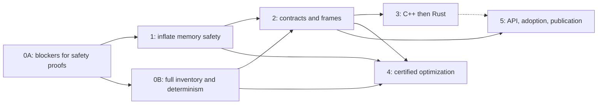

# Roadmap

What we want to be true of `ir-lean`, in what order, and how we'd know we were wrong. For what's true
today, see [status](status.md). For what any theorem means, see [trust](trust.md).

Nothing here is a promise of dates. Effort figures are estimates that hold only if the gates before them
pass, and they get redone at each gate. Every threshold is a proposal, to adjust as we learn, but any change
gets written down here with its reason, so that a gate can't quietly move.

## The goal

Prove the foundation first. Point `ir-lean` at code compiled by stock compilers and get a Lean
theorem about that exact compiled code, against a semantics that people have good reason to believe,
at a cost someone would actually pay.

The work is ordered so each step rests on the one before it:

1. **Fidelity.** The LLVM IR to Lean translation and its semantics are faithful, and where they aren't, the gap is written down, tested, or refused. Nothing else is worth much without this.
2. **The headline.** Real zlib `inflate`, compiled at `-O2`, proved memory-safe.
3. **Reusable primitives.** Contracts and frame reasoning, so that the next function is cheaper than the last and proofs compose across calls.
4. **Other languages.** The same primitives on one C++ and one Rust demonstration, over LLVM IR.
5. **Certified optimization.** Proof-checked translation validation and superoptimization, only once the foundation is proved. It is a future phase and not a near-term goal.

The three pillars this builds toward are systems correctness proofs, memory-safety proofs and, later,
refinement certificates. All three are statements about LLVM IR, and the
[trust model](trust.md) says exactly what that does and doesn't give you.

Some of this has moved faster than the order above: [LLVM's own code](llvm.md) proves real functions from `llvm-project`, without
Phases 1 and 2 being done. It doesn't replace them: it has no contracts between functions.

### Language priorities

These are in the order we validate them. Other front ends may produce IR that translates, but we make
no claims about them and spend no effort on them until these three work.

| Order | Language | Status | Where it gets validated |
| --- | --- | --- | --- |
| 1 | C | Three proofs against clang's `-O2` output, including real zlib | Phases 0 and 1 |
| 2 | C++ | [Small probes only](status.md#probes-for-later-phases) | [Phase 3](#phase-3-c-and-rust-demonstrations) |
| 3 | Rust | [Small probes only](status.md#probes-for-later-phases) | [Phase 3](#phase-3-c-and-rust-demonstrations) |

### What this project won't do

- Claim that a C, C++ or Rust source program is verified. That needs a proof about the front end's
  lowering, which we don't have and don't plan.
- Claim anything about machine code without a correspondence argument, which we don't have.
- Compile general Lean 4 programs to LLVM IR. See [IR and Lean, both ways](design.md#ir-and-lean-both-ways).
- Trust an AI's output. AI provers and search tools are welcome, and nothing they produce counts until
  the Lean kernel has checked it and a person has read the theorem statement.

## Now, next, later

| Horizon | Work | Why it's here |
| --- | --- | --- |
| **Now** | [Phase 0](#phase-0-semantic-fidelity-and-trust-infrastructure) fidelity and pinned pipeline. [Phase 1](#phase-1-zlib-inflate-memory-safety) starting with `inflate_table` | A proof is only as good as its semantics, and `inflate` tests the riskiest thing left |
| **Next** | [Phase 2](#phase-2-reusable-contracts-and-frame-reasoning) contracts and the cost comparison. [Phase 3](#phase-3-c-and-rust-demonstrations) C++ and Rust | Only worth generalizing once `inflate` shows what's actually needed |
| **Later** | [Phase 4](#phase-4-certified-translation-validation-and-superoptimization) certified optimization. [Phase 5](#phase-5-public-api-adoption-and-publication) adoption and publication | Contingent on the phases before them |



Phase 4 waits on Phases 0, 1 and 2 on purpose. Phase 5 doesn't wait on Phase 4, and the dashed line means
Phase 3 strengthens it without being required.

### Milestones

Each is reached when its checks pass in CI, not on a date.

| | Milestone | Depends on | Status |
| --- | --- | --- | --- |
| M0 | Phase 0A done: axioms allow-listed, GEP gaps closed, pinned target and manifest | | In progress: axioms, GEPs and allow-lists are done |
| M1 | `inflate_table` proved: entries stay inside `codes`, links stay in the table | M0 | Not started |
| M2 | `inflate_fast` proved safe, given such tables | M1 | Not started |
| M3 | The invariant holds across `inflate`'s stored-block path | M2 | Not started |
| M4 | **Headline:** `inflate` proved memory-safe | M3 | Not started |
| M5 | Phase 0B done: full inventory, semantic mutation, two-machine determinism | M0 | In progress: promises, model stops and Alive2 are done |
| M6 | Contracts reused by three callers, and the cost comparison published | M4, M5 | Not started |
| M7 | C++ demonstration | M6 | Not started |
| M8 | Rust demonstration | M7 | Not started |
| M9 | First outside user, or an accepted bug found with this tool | M6 | Not started |
| M10 | Refinement certificates on pure integer code, compared with Alive2 | M6 | Not started |
| M11 | Certificates with memory and loops, and safety carried across refinement | M10 | Not started |

## Phases

Each phase lists what it needs first, what it must show, and when to stop.

### Phase 0: semantic fidelity and trust infrastructure

**Goal:** every statement in the [trust model](trust.md) is either checked by a test, closed, or
listed as an assumption of each theorem it affects.

**Prerequisites:** none. This is where to start.

**0A, which blocks safety proofs:**

- Done: axioms allow-listed in `tests/proofs.sh`, the [GEP gaps](trust.md#closed) closed with negative tests, and
  function attributes and linkage refused unless reviewed.
- Pin the target in `tests/zlib.sh`, as `tests/proofs.sh` already does through `PROOF_CFLAGS`.
- Write a manifest next to each generated module: hashes of source and `.ll`, compile flags, compiler,
  LLVM and Lean versions, triple, data layout, emitter commit, axioms, and the list of promises the
  theorem assumes.
- State well-formed layouts as a predicate, with lemmas replacing hypotheses like `hnn`.

**0B, which blocks Phases 2 and 4:**

- **Inventory:** `ir-lean --report` lists, for an input, every opcode, intrinsic, attribute, metadata
  kind and linkage it saw, and how each was handled. A table in the repo classifies each as modeled,
  refused or assumed.
- **Promises:** done for what zlib's IR contains, [apart from `mustprogress` and `willreturn`](trust.md#known-gaps-in-the-model).
  What Rust emits everywhere, starting with `noalias` on arguments, is refused until [Phase 3](#phase-3-c-and-rust-demonstrations)
  needs it. An independent check of these rules, as Alive2 is for GEPs, is still to try.
- **Poison, `undef`, provenance:** write down the choice for each, with its direction and a test.
- **Mutation beyond the C:** change each `Val.*` and `Mem.*` definition, and each emitter case, and
  require some test to fail. Survivors show what the tests can't see.
- **Hermetic pipeline:** Lean from a pinned source, and LLVM pinned to a version and not `_latest`. Record what
  each LLVM bump breaks. Alive2 is on a known LLVM, and CI fails when it's missing.
- **Determinism:** `.ll`, `.lean`, manifest and axiom lists are byte-identical on two independent machines
  for the same target, and proofs check on the supported hosts.

**Demo:** an out-of-bounds-and-back GEP stops the model, which is done. What's left is its theorem's manifest
showing every assumption that theorem rests on.

**Exit criteria:**

- Every instruction, intrinsic, attribute, metadata kind and linkage kind in the pinned LLVM is classified,
  anything unclassified is refused, and a test fails if an LLVM bump adds a new one.
- Every row of [Known gaps](trust.md#known-gaps-in-the-model) is closed, refused, or an explicit assumption, with
  at least one negative test for each row that can have one.
- At least 95% of semantic and emitter mutants are killed, and each survivor has a written reason.
- Two machines produce identical hashes for all generated artifacts on a pinned target, in CI.

**Risks:** the inventory grows without end, or closing a gap breaks existing proofs.

**Hold or pivot:**

- 0A must not wait on 0B. If `inflate` work stalls on a 0B item, record the assumption and move on.
- This is a foundation for optimization proofs, so correctness beats proof cost. If closing a promise needs a
  heavier model, build it, as [#19](https://github.com/phongndo/ir-lean/pull/19) did. Until it's built, refuse
  it, as with `tbaa`. A stated assumption is the last resort, and doesn't work for refinement.
- If a fix invalidates `adler32` or `crc32`, that's a real finding. Update the proof, don't weaken the fix.

### Phase 1: zlib inflate memory safety

**Goal:** the headline. For any input bytes, real zlib `inflate`, as clang compiles it at `-O2`, stays
inside its buffers across calls.

**Prerequisites:** 0A. The GEP gaps are exactly the kind of thing this theorem could be wrong about.

**The statement,** which is the first deliverable, and gets reviewed before any large proof:

```lean
-- A sketch of the target, not a proved theorem. Names and shape will change.
theorem inflate_safe (h : StreamInv m strm) (hc : CallerBuffers m strm) :
    ∃ code m', inflate (some strm) (some flush) m = Outcome.ok (code, m') ∧
      (StreamInv m' strm ∨ Finished code)
```

It also says `inflate` finishes. That's on purpose: 28 of zlib's functions have loops marked
`llvm.loop.mustprogress`, and LLVM calls one of those that spins undefined, where the model says `none`. A theorem
that allowed `none` would [have a hole there](trust.md#known-gaps-in-the-model). This makes the proof harder, and it has to assume the
allocator returns. It says nothing about decompressing correctly, which could come later as a separate theorem.

**Scope and preconditions** to settle in that review:

- **Entry points:** `inflateInit2_`, repeated `inflate`, and `inflateEnd` first. Others, such as
  `inflateSetDictionary` and `inflateCopy`, come after.
- **Quantifiers:** all input bytes, however they're split across calls, with any `avail_in`, `avail_out`
  and `flush`. `Mem.failAlloc` covers `malloc` failing, and `base` covers layouts.
- **What the caller must do:** valid `next_in` and `next_out` for their stated sizes, between calls, and
  no writes to `state`. A caller who corrupts the stream is outside the theorem.
- **Allocator callbacks:** `updatewindow` calls through `strm->zalloc`, so the precondition has to name
  the allocators allowed. A call to anything else stops the model.
- **Gzip headers:** `inflateGetHeader` is in or out, decided on purpose. In, it would cover the code behind
  CVE-2022-37434.
- **Build flags:** which `INFLATE_*` options, and whether `inflateUndermine` is ever called.

**What the invariant must say** about `inflate_state`:

- Where `next_in`, `next_out`, `window` and `state` point, and how far each is valid.
- Bounds on `hold`, `bits`, `have`, `nlen`, `ndist` and `wnext`, per decoding mode.
- That `lencode` and `distcode` point into `codes` or the fixed tables, and every link in them stays in
  bounds. This is what `inflate_table` has to establish, and the riskiest part.
- That `inflate_fast`'s window copies stay in range.

**The order,** so each step tests the riskiest thing left:

1. `inflate_table`: every entry it writes stays inside `codes`, and links stay in the table it built.
2. `inflate_fast`, assuming tables with that property. This is where a memory bug would most likely be.
3. The invariant across `inflate`'s modes, one mode at a time, starting with stored blocks.

`inflate` also calls `updatewindow` and the proved `adler32` and `crc32`, so this phase writes its own
contracts by hand. That's on purpose: Phase 2 generalizes from what they turned out to need.

**Runtime memory model:** alongside the proof, make the semantics fast enough to run. Memory is currently
a chain of closures, which is why inputs stop at about 800 bytes. Add an executable representation, prove
it agrees with `Mem`, and use it for the differential tests. `inflate`'s window is 32 KiB, so inputs under
that never exercise its full distance range.

**Demo:** the theorem, its manifest, and a table of old bugs put back that make it stop checking.

**Exit criteria:**

- The theorem checks in CI with no `sorry` and only allow-listed axioms, and a person other than its
  author has reviewed the statement.
- At least 10 bound-related mutants across `inftrees.c`, `inffast.c` and `inflate.c` each break the proof,
  including, where they're in scope, reverting the fixes for CVE-2016-9840, CVE-2016-9841 and
  CVE-2022-37434.
- The differential harness runs on inputs of at least 128 KiB, with no mismatches and none skipped.
- Cost is published: lines per IR instruction, invariant lines, check time and peak memory per module.

**Risks:** the invariant is the unknown. It might not be expressible per mode, and table links may need
far more math than bounds. Whole-proof check time and memory might be too much for CI.

**Hold or pivot:**

- `inflate_table` goes past about 30:1 proof to code: stop and rethink.
- The invariant keeps needing to change with each new mode: stop and rethink.
- If the whole theorem stays out of reach, a proved `inflate_table` and `inflate_fast` with the rest stated
  as assumptions is still worth publishing, labeled as exactly that.
- If the proof finds a real bug: report it privately to zlib's maintainers first.

**Effort:** about 3,000 lines of running blocks is the one estimate. The invariant is unmeasured. Redo this
after step 1.

### Phase 2: reusable contracts and frame reasoning

**Goal:** the proof of a caller doesn't look inside its callees, and the next function is cheaper.

**Prerequisites:** M4 and 0B. Extract from `inflate`'s real contracts. Don't design this in the abstract.

**Work:**

- **Function contracts:** a precondition, a result, and exactly what memory changed, with a tactic for
  applying one at a call.
- **Frame reasoning:** writes to one allocation or range leave others alone, without re-proving it per
  function. `Mem`'s block structure makes separate allocations easy, and ranges in one allocation are the
  real work. Start with plain lemmas, and adopt separation logic only if they stop being enough.
- **Open modules:** calls outside a module are refused today. Pass external functions to generated code
  as parameters, so a theorem holds for every implementation meeting a contract, adding no axioms. C++ and
  Rust both need this for allocation and panics.
- **Spec libraries:** RFC 1950, 1951 and 1952 kept apart from any one implementation, so C, C++ and Rust
  proofs can share a spec.
- **Proof maintenance:** measure what breaks on an LLVM bump and on a zlib release, then make block proofs
  resilient, since they're tied to block names and allocation numbers today.
- **L2:** the same scripts against `aarch64-linux-gnu` IR.
- **Cost comparison:** the one the original plan asked for and hasn't done. See below.

**The comparison.** Do `adler32` in at least Frama-C/WP and VST, recording person time, AI cost, lines of
spec and proof, check time, and what's trusted. Then SAW if time allows. These prove different things,
since they mostly work from source and we work from compiled IR. So report both the cost and the theorem's
scope, and don't reduce it to one number. Alive2 belongs in Phase 4's comparison and not here, since it
checks refinement between two programs and doesn't prove a property of one.

**Demo:** proofs of `uncompress2`, using `inflate`'s contract, and `inflateSetDictionary`, using those of
`adler32` and `updatewindow`, without unfolding any of them.

**Exit criteria:**

- Three callers use proved contracts with no callee unfolded in their proofs.
- Over three successive new functions, block lines per IR instruction stay at or below `crc32`'s 0.63,
  and at least 60% of each proof's lemmas come from the shared library.
- The comparison is published, with the raw effort records.
- The cost of an LLVM bump on existing proofs is measured over at least two real bumps.

**Risks:** abstractions that fit only `inflate`, or tactics slow enough to undo the gains.

**Hold or pivot:**

- If the second and third functions aren't clearly cheaper, stop and find out why before adding more.
- If Frama-C or VST gives the same confidence for much less work on C source, narrow this project's claim
  to what they don't give: theorems about compiled output, and shared reasoning across languages.

### Phase 3: C++ and Rust demonstrations

**Goal:** show that the primitives are about LLVM IR and not about C, with one real C++ and one real Rust
proof using the same statements and lemmas.

**Prerequisites:** Phase 2. C++ comes first, because it's closer to what already works.

**The demos:** one spec, three compilers would be the sharpest result: `Adler.spec` reused against a C++
implementation and a Rust one, such as the `adler2` crate. Prefer real library code to code written for the
demo, and confirm the choice with a probe at the start of the phase. Theorems are about the IR of those
functions, with the flags and versions recorded.

| | C++ | Rust |
| --- | --- | --- |
| **Starts as** | `-fno-exceptions -fno-rtti`, no standard library calls that aren't inlined | `no_std`, `panic=abort` |
| **Runtime and calls** | `operator new` and `delete`, `__cxa_*` through contracts | `__rust_alloc`, and panics through contracts |
| **Unwinding** | `invoke` and `landingpad` refused, so exceptions are out of scope at first | The same for `panic=unwind` |
| **Layout and ABI** | Itanium ABI and vtables come from the front end, and are read as bytes and addresses in the IR | `repr(Rust)` is unstable and niche-optimized, so a theorem holds for that compiled layout only |
| **Linkage** | `linkonce_odr` is refused today. Decide whether the one-definition rule is an assumption of the theorem | Generics are monomorphized in, and `core` may or may not be inlined |
| **Promises** | Fewer than Rust. TBAA is left out with `-fno-strict-aliasing` | `noalias` on arguments, refused today, and `dereferenceable` and `range` everywhere, so Phase 0's decisions matter most here |
| **Gaps in the probes** | External `operator delete`, exceptions | `undef` in `phi`, external panics |
| **Version skew** | Same compiler as the emitter | `rustc`'s LLVM differs, and the emitter upgrades its IR on reading. Pin it, or use a matching LLVM |
| **Language guarantees** | The object model and lifetimes aren't in the IR | The borrow checker's guarantees aren't proved here, and aren't assumed either |

**What these don't show:** that a C++ or Rust program is verified. Source-level tools such as Aeneas are
different and complementary, and a Rust theorem here says nothing about safe Rust as a language.

**Demo:** the same theorem shape on all three languages, with a table of what each one assumed.

**Exit criteria:**

- One C++ and one Rust theorem in CI, each with at least 3 must-break mutants and a manifest.
- No new axioms, and at most 30% of each proof's lines are specific to the language.
- Lines per IR instruction are within a factor of 2 of the C baseline.

**Risks:** Rust's promises can't be modeled affordably, so every theorem carries a long assumption list. Real
library code may need so many runtime contracts that the demo stops being representative.

**Hold or pivot:**

- If language-specific lines stay above 50%, the primitives aren't general. Return to Phase 2, not onward.
- If Rust stalls on promises, ship C++ and publish the Rust blockers as the result.

### Phase 4: certified translation validation and superoptimization

**This phase is contingent.** It doesn't begin until M6, and isn't a near-term goal. Until then, the only
work on it is keeping Phase 0's choices compatible with it, which is why they separate model stops from UB.

**Goal:** for a proposed replacement of code, whoever proposed it, Lean checks a theorem that it refines the
original. Search tools and AI are untrusted, and only the certificate counts.

**Prerequisites:** M6, a decision on `undef`, and an answer for `mustprogress`: deleting a loop that never ends can't
be certified while the model says the source hangs and the target returns. Memory stages need Phase 2's frame
reasoning.

**What's being certified:**

```lean
-- A sketch, not in the library. The model's two kinds of stop must be told apart.
def Refines (src tgt : Input → Mem → Outcome (Val w × Mem)) : Prop :=
  ∀ i m, Layout.WF m → match src i m with
    | realUB        => True   -- the source allows anything here
    | modelStop     => False  -- the model doesn't know, so no certificate
    | diverges      => tgt i m = diverges
    | returns r s   => ∃ r' s', tgt i m = returns r' s' ∧ r ⊑ r' ∧ s ⊑ s'
```

The hard parts are here, and they're mostly not the arithmetic. Poison and `undef` on each side, with the
polarity problem [in the known gaps](trust.md#known-gaps-in-the-model). A target may allocate differently, so allocation numbers
don't line up, and memory needs a relation instead of equality. Promises are checked or refused, so a target can't
claim one the certificate didn't check, apart from `mustprogress` and `willreturn`.

**Stages,** each opened only by the one before:

1. **Pure, loop-free integer code.** Using shallow generated functions and `bv_decide` where widths are fixed. Benchmark against Alive2 on LLVM's InstCombine tests and a set of known miscompilations.
2. **Loops and memory,** with real function pairs from `opt` passes. Prove the bridge between safety and refinement: `Safe src → Refines src tgt → Safe tgt`, so a safety proof carries to optimized code.
3. **Real search.** Candidates from LLVM itself, Souper, Minotaur or an LLM, all untrusted, represented through [Lean to IR](design.md#ir-and-lean-both-ways). Benchmark against what `opt -O2` already produces.

**Demo:** a candidate from an untrusted source, certified, on a block of real zlib, with its safety theorem
carried across.

**Exit criteria:**

- Stage 1: no known miscompilation gets a certificate, and each disagreement with Alive2 over at least 500
  transformations is explained as an Alive2 timeout, a model bug or an Alive2 bug.
- Stage 2: at least 20 real function pairs are certified, including at least 5 where Alive2 is inconclusive,
  and the safety bridge is proved.
- Stage 3: a measured improvement over `opt -O2` on real code by code size or `llvm-mca` cycles, and at least
  one result accepted upstream by LLVM.

**Risks:** this field is moving quickly. [Trivet](https://arxiv.org/abs/2609.19583), from September 2026,
already does LLM-assisted refinement proofs in Lean on integer code, on top of Lean-MLIR. It has no memory
model and no `undef`, and supports a restricted loop class. Stage 1 may simply duplicate it.

**Hold or pivot:**

- Before stage 1, read Trivet and Lean-MLIR closely. If they cover it, contribute to them or share a
  semantics, and put our effort where memory and whole real functions differ.
- If certificates cost far more than Alive2 for no gain in what's covered, stop at stage 1.
- If no certified candidate beats `opt -O2` on real code after stage 3 has had a fair try, publish that, and
  keep translation validation without the search.

### Phase 5: public API, adoption and publication

**Goal:** someone outside the project gets a real result with this, without our help, and can reproduce ours.

**Prerequisites:** Phase 2 for the API. Phase 3 makes the claim stronger, and isn't a hard requirement for the
first outside user. This phase doesn't depend on Phase 4.

**Work:**

- **A license.** The repo doesn't have one, so no one outside can safely use it. This is the maintainers'
  decision, and should come well before the rest of this phase.
- **A stable surface:** versioned `IRLean` modules, contract and tactic APIs, a documented manifest, and a
  `ir-lean` command line with a compatibility policy.
- **A contributor path:** a walkthrough from a small C function to a checked theorem, in an hour.
- **An artifact:** a pinned, reproducible package that rebuilds every published claim from sources.
- **Papers,** with each result stating its scope in the terms of the [trust model](trust.md).

**Demo:** an outside project's theorem running in that project's own CI.

**Exit criteria:**

- At least two outside projects use it without maintainers writing their proofs, or at least one real bug
  found with it is accepted upstream.
- An independent party rebuilds a published result from the artifact, with matching hashes.
- API changes follow the stated policy across at least two releases.

**Risks:** the cost is too high for anyone not doing this as research, or the C-only value is too small.

**Hold or pivot:**

- If no one wants it after outreach with M4 in hand, find out why before building more API.
- If someone else ships the same thing, contribute to theirs instead.

## Near-term pull requests

Small, independent slices, roughly in order. Each is reviewable alone.

Done: axiom allow-list ([#11](https://github.com/phongndo/ir-lean/pull/11)), Alive2 required and on the same LLVM
([#13](https://github.com/phongndo/ir-lean/pull/13)), model stops ([#14](https://github.com/phongndo/ir-lean/pull/14)),
GEP flags ([#15](https://github.com/phongndo/ir-lean/pull/15)), attribute and linkage allow-lists
([#16](https://github.com/phongndo/ir-lean/pull/16)), `-fno-strict-aliasing` and refusing `tbaa`
([#18](https://github.com/phongndo/ir-lean/pull/18)), and the promise model
([#19](https://github.com/phongndo/ir-lean/pull/19)).

| # | Slice | Phase | Done when |
| --- | --- | --- | --- |
| 6 | Pin the target in `tests/zlib.sh`, as `tests/proofs.sh` already does | 0A | Generated IR's triple is the pinned one on any host |
| 7 | Write a manifest for each generated module | 0A | Each proof's manifest has hashes, versions and axioms |
| 8 | `Layout.WF`, with lemmas replacing `hnn` and alignment hypotheses | 0A | `adler32` and `crc32` use it, with statements no weaker for real layouts |
| 10 | `--report` lists opcodes, intrinsics, attributes, metadata and linkage | 0B | Zlib's list is checked into a table, and a change fails a test |
| 12 | Semantic mutation script | 0B | Kill rate is reported, with survivors triaged |
| 13 | Statement of `inflate_table`'s theorem, for review, with no proof | 1 | Someone other than the author has reviewed it |
| 14 | `inflate_table` proof | 1 | Checks in CI, costs recorded, and the 30:1 gate evaluated |
| 15 | Executable memory representation, proved to agree with `Mem` | 1 | Differential tests run past 800 bytes |
| 16 | An independent check of the promise rules, as `tests/gepcheck.py` is for GEPs | 0B | Each rule Alive2 can express is checked against it, and the rest are listed |

## How we measure

Keep these in one report, generated by CI once slices 7 and 10 exist. A number there should link to the run
that produced it. Current values live in [status](status.md).

| Metric | Measured yet | Why it matters |
| --- | --- | --- |
| zlib functions translated | Yes | Coverage, a low bar |
| Differential results and input size | Yes | Fidelity evidence, limited by size |
| IR features classified | No | Fidelity |
| Known gaps open | [Listed](trust.md#known-gaps-in-the-model) | Fidelity |
| Mutants killed in C | Yes | Do proofs depend on the code |
| Mutants killed in semantics and emitter | Partly, as a one-off for GEPs and promises | Do tests depend on the model |
| Assumptions per theorem | No | How much a theorem really says |
| Lean lines per IR instruction, for blocks | Yes | Whether cost falls |
| Lean lines per line of C, in total | Yes | Whether cost falls, overall |
| Check time and peak memory | Partly | Whether it fits in CI |
| Proof lines broken per LLVM bump | No | Whether anyone can maintain this |
| Identical hashes across machines | No | Reproducibility |
| Outside users, accepted bugs | None so far | Whether it matters to anyone else |

## When to stop or change course

These apply across phases. The ones specific to a phase are with that phase.

- The next proof past `inflate_table` isn't cheaper, and no reason can be found.
- A fidelity gap can't be closed, refused or stated as an assumption. That undermines the claims, so it comes
  ahead of any proof in progress.
- The proofs break on each LLVM update faster than they can be maintained. Then pinning is the honest answer,
  and the project should say so.
- Someone else ships the same thing. Contribute to theirs instead.
- Frama-C or VST gives the same confidence for less work on the same question. This project isn't needed for
  that job.

## Prior art

Read these before starting the phase they apply to. This list isn't complete, and the field is moving, so
check it again at each gate. The "someone else ships it" rule depends on that.

| Work | What it does | How it relates |
| --- | --- | --- |
| [Alive2](https://www-old.cs.utah.edu/~regehr/alive2-pldi21.pdf) ([code](https://github.com/AliveToolkit/alive2)) | Bounded, SMT-based translation validation for LLVM, avoiding false alarms | Our oracle for integer semantics now, and the benchmark for Phase 4. It's bounded on loops and produces no proof object |
| [Vellvm](https://www.cis.upenn.edu/~stevez/papers/ZB+21.pdf) | A large sequential subset of LLVM IR in Rocq, built on interaction trees | The closest formal semantics. Compare our choices with it in Phase 0, especially on memory |
| [LangRef](https://llvm.org/docs/LangRef.html) and [the UB guide](https://llvm.org/docs/UndefinedBehavior.html) | LLVM's own semantics, in prose | The reference for every row of Known gaps |
| [Crellvm](https://sf.snu.ac.kr/crellvm/) | LLVM passes emit proofs, checked by a verified checker in Coq, for `mem2reg` and GVN | The model for per-run certificates in Phase 4 |
| [Lean-MLIR](https://github.com/opencompl/lean-mlir) ([paper](https://arxiv.org/abs/2407.03685)) | Peephole rewriting over SSA IRs, verified in Lean | The closest Lean work, and worth sharing with in Phase 4 |
| [AliveInLean](https://link.springer.com/chapter/10.1007/978-3-030-25543-5_25) | A verified LLVM peephole verifier, in Lean | Earlier Lean work on the same problem |
| [Trivet](https://arxiv.org/abs/2609.19583) | LLM-assisted refinement proofs and refutations in Lean. 147 of 148 cases, integer only, no memory, restricted loops | Directly overlaps Phase 4's stage 1 |
| [Souper](https://arxiv.org/abs/1711.04422) ([code](https://github.com/google/souper)), [Minotaur](https://arxiv.org/abs/2306.00229) | Synthesizing superoptimizers for LLVM IR, with Minotaur on SIMD | Possible untrusted candidate sources in Phase 4 |
| [SAW](https://github.com/GaloisInc/saw-script) | Reasons about LLVM bitcode against Cryptol specs, used on s2n's HMAC | Closest in spirit for proving properties of compiled IR. A comparison in Phase 2 |
| [Frama-C](https://frama-c.com/) | ACSL specs and weakest-precondition proofs on C source | Cost comparison in Phase 2, and a different scope |
| [VST](https://vst.cs.princeton.edu/) | Separation logic for C, proved sound in Rocq | Cost comparison in Phase 2, and a model for frame reasoning |
| [Aeneas](https://github.com/AeneasVerif/aeneas) ([recent report](https://arxiv.org/abs/2609.15648)) | Translates Rust to Lean, for proofs at the source level | Complements Phase 3: it covers Rust's meaning, and we cover compiled output |
| [lean-zip](https://github.com/kim-em/lean-zip) | A DEFLATE codec written in Lean, with a proved round trip | Doesn't prove anything about C zlib. Its spec might help a later functional proof of `inflate` |
| [LNSym](https://github.com/leanprover/LNSym) | Symbolic simulation of Arm machine code in Lean | Where to look if machine-code correspondence ever gets taken up |

## Open questions

The ones with the most leverage, for research collaborators: the `inflate` invariant, what to do about
`mustprogress`, `noalias` on arguments and TBAA, and how far a check inside Lean can replace trust in the emitter.
